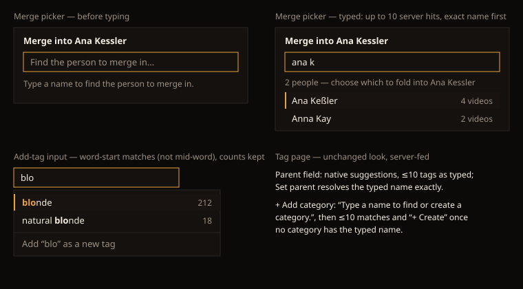

# Design handoff: bounded picker search (HOLODEX-586)

**Approved by the owner 2026-10-18** (mockup below). Parent story: HOLODEX-354. Rules:
[entity-identity RD8a](../specs/entity-identity.md), [tag-governance P0-8a](../specs/tag-governance-and-video-enrichment.md),
[tag-detail parent/category](../specs/tag-detail-hierarchy-and-categories.md).

Four surfaces used to load a whole entity table and filter it in the browser. Each now asks the server
for a few matches as the owner types. The look, keyboard and focus behaviour are unchanged, except
for what is listed here.

## Merge picker (`entity/EntityPicker.svelte`)

- **At rest:** the list is empty, and the status line reads "Type a name to find the {noun} to merge in."
  It used to open on the first 50 entities.
- **Typed:** after a 300 ms pause it shows up to 10 matches (exact name first) with video counts. While the
  first answer is pending, the status line reads "Searching {nouns}…". Older rows stay until the new answer
  lands.
- **Enter** picks the highlighted row only once the rows answer the current text, so it never picks an
  older query's row.
- The confirm step is unchanged: both video counts, Back / Merge.

## Add-tag input (`entity/TagAddInput.svelte`)

- Suggestions match the start of the name or of a word in it. "lond" no longer finds "blonde", but "blo"
  finds "natural blonde". There are still at most 8 rows, names that start with the text come first, and
  counts are kept.
- The "Add “x” as a new tag" row appears only once the server has answered the current text, so it
  doesn't flash for a name that exists. Enter and Tab work as before.

## Tag page parent field (`routes/tags/[id]`)

- The native `<datalist>` stays, filled with up to 10 server matches as the owner types.
- **Set parent** resolves the typed name with its own search, so a fast Enter never checks against stale
  rows. The "No tag named …" error is unchanged.

## Category picker (`entity/CategoryPicker.svelte`, tag page "+ Add category")

- With no `categories` prop the picker searches the server: "Type a name to find or create a category."
  at rest, up to 10 matches, and "+ Create “x”" once no category has the typed name.
- With a `categories` prop (the `/tags` list's remove mode) it filters in the browser as before.

## States to QA (Cinémathèque)

Empty hint · searching · results with counts · no match · server error (warn text) · Enter during a
pending query.
