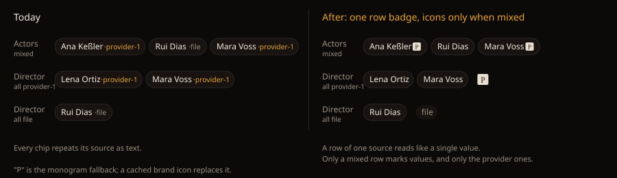

# Design Handoff — Chip-row provenance (HOLODEX-144)

## Overview

A field list shows provenance two ways today. A single value carries a `ProvenanceBadge`: the
provider's brand icon, or a muted `file` / `custom` pill. A chip row (Genres, Actors, aliases)
instead ends every chip with a `·tmdb` / `·file` text suffix. On an enriched page a visitor sees
both looks side by side, and a 30-actor row repeats `·tmdb` thirty times.

After this change a chip row speaks the single-value language. The owner picked this option on
2026-10-24 from three: an icon on every chip, a row badge with icons only when the row is mixed
(this one), or plain chips with every source listed at the row's end. The middle option keeps
"which value came from where" on screen only when it carries information.

HOLODEX-92, which asked for the per-field badge to link to the provider's page, was closed on the
same day. The only provider URL is per entity, and the title's `ProviderLinkBadge` already opens
it.

## The rule

Each value in the row gets a **provenance key**:

- **manual** when the value is a custom (owner-added) value;
- otherwise **the first provider** in its sources (any source that isn't the file baseline, the
  record baseline or manual);
- otherwise **baseline**.

Then:

| Row | What renders |
|---|---|
| Every value has the same key | Plain chips, then **one** `ProvenanceBadge` after the last chip, exactly what a single value with that key shows: the provider's icon (16px), the `file` pill, or the `custom` pill |
| The keys differ (a mixed row) | Plain chips, **no** row badge. Each chip whose key is a provider ends with that provider's `ProviderIcon` at 12px; baseline and manual chips carry no mark |
| Empty row | Nothing; the row isn't rendered (unchanged) |

Why baseline and manual chips go unmarked in a mixed row: the file is the default truth, so the
marks point at what came from somewhere else. The owner still tells a custom value apart by its
edit controls and in the source chooser.

## Where it applies

`CurationChip`'s plain (non-radio) branch, as mounted by `CurationFieldRow`. That covers media
merge fields and visitor replace fields, plus person and studio merge fields, for visitor and
owner alike. The row decision lives in `CurationFieldRow`, which knows every value; the chip takes
one new optional prop (the provider to mark, or none) instead of computing its own suffix.

**Out of scope, and they keep their text:**

- The radio chips in `SourceBadge`, `SourceChipRow`, `SourceImageTiles` and the writeback dialog.
  There the label names a *candidate source* the owner is choosing between: it's the content of
  the choice, not a provenance mark.
- `ChipValueList`, which already shows one row badge.
- `UrlValueList`, which already leads each link with an icon.

## Components

| Component | Change |
|---|---|
| `CurationFieldRow` | Computes the row's keys. If they're uniform, renders `ProvenanceBadge` after the chips (before the owner's `+ Add`) and passes no mark to the chips; if mixed, passes each provider chip its provider |
| `CurationChip` (plain branch) | Drops the `·{provenance}` span. With a mark, renders `ProviderIcon` `size={12}` `decorative` after the value (inside the chip's existing `gap-1`), wrapped in a span whose `title` is `from tmdb` (or `from tmdb and file` when the value has several sources) |
| `ProvenanceBadge` | Unchanged. Its own `ml-2` plus the row's `gap-1.5` puts 14px between the last chip and the badge, a gap that reads as "about the row", not "about the last chip" |

## Measurements and tokens

- **Chip:** unchanged from HOLODEX-357. 24px tall (`min-h-6`), `px-2`, `text-xs`, `rounded-full
  border-rule bg-surface-2 text-ink`, `gap-1` inside. A marked chip grows by 16px (4px gap + 12px
  icon). An unmarked chip shrinks by the old suffix, about 21–31px.
- **12px icon:** `ProviderIcon` on `bg-logo-plate`, `rounded-theme`. The monogram falls back at
  the same size. A wide brand image may run past 12px wide (the component caps it at four times
  its height), and the chip grows with it.
- **Row badge:** `ProvenanceBadge` as it is: 16px icon, or the `text-xs` muted pill.
- No new colours. The accent that used to tint a provider suffix goes away, since the icon now
  carries the brand.

## States and interactions

| Element | State | Behaviour |
|---|---|---|
| Row badge, chip icon | Hover | Native tooltip, `from <sources>`. Neither one is interactive, so no 24px target applies |
| Chip (owner) | Hover / focus | Unchanged: edit, don't-write and remove controls reveal. The icon sits before them |
| Chip, don't-write | — | Unchanged: struck through at reduced opacity. The icon stays inside the chip and is dimmed with it |
| Row, after an edit | Values change | The rule re-runs: adding one file value to a tmdb row turns it mixed (the badge goes, the icons appear); removing it turns it back |
| Provider directory still loading | — | The monogram shows until `providers.load()` resolves, the same as every badge today |

## Edge cases

- **One value:** a uniform row of one, so it gets the row badge, exactly like a single-value field.
- **A value with several providers** (`tmdb + tvdb`): keyed by the first provider; the tooltip
  names them all.
- **A value both the file and a provider agree on** (`tmdb + file`): keyed to the provider, as the
  accent suffix was.
- **Long rows** (30 actors): a uniform row ends with one badge on the last wrapped line; a mixed
  row marks only its provider values. Either way it's shorter than today.
- **Person and studio baselines** (`record`): the row badge shows the same `file` pill a single
  value shows on those pages today. Fixing that wording is out of scope.
- **Narrow widths:** the badge is a flex item in the same wrapping row, so it wraps with the last
  chip and never overflows (`no-horizontal-page-overflow` keeps guarding it).

## Accessibility

- **The value's source stays announced.** The chip keeps `aria-label="<value>, from <sources>"`.
  The 12px icon is `decorative`, so screen readers don't read the source twice.
- **The row badge keeps `ProvenanceBadge`'s labelling:** icon alt or title `from tmdb`, or the
  pill's `aria-label`.
- No new focus stops and no change to the owner's keyboard order.
- **Colour isn't the signal.** The mark is the brand icon or monogram; the old accent-versus-muted
  text tint goes away.

## QA (Cinémathèque)

1. **Uniform tmdb row on media 902:** one 16px icon after the last chip, and no `·` text anywhere
   in the row.
2. **Mixed row:** only the provider chips carry a 12px icon, and the file chips are bare.
3. **All-file row:** the `file` pill after the last chip.
4. **Owner view of the same rows:** the edit controls still reveal on hover; `+ Add` follows the
   badge.
5. **The owner source chooser is unchanged:** the radio chips still read `·tmdb` / `·file`.
6. **Phone width:** a long uniform row wraps with the badge on the last line and no horizontal
   overflow.
7. **Screen reader:** each chip reads "value, from tmdb" once.
