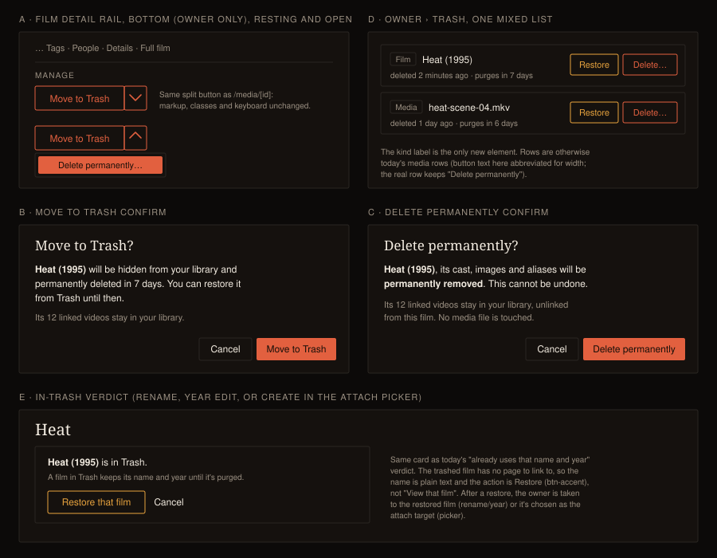

# Design Handoff: Delete a film (F78)

**Spec**: [Delete a film (F78)](../specs/delete-film.md) · **Builds on**:
[delete-media-handoff.md](delete-media-handoff.md) (confirm dialog, Trash rows) and
[manage-split-button-handoff.md](manage-split-button-handoff.md) (the split button).
**Theming**: tokens only, QA Cinémathèque ([theming.md](theming.md)).
**Approved**: mockup panels A to D by the owner in chat, 2026-10-11. Panel E is the visual form of
spec RD6, which the owner settled in words.

---

## Overview

Four owner-only surfaces change. Nothing new renders for a visitor or for the owner in visitor
view.

1. **Film detail page**: a *Manage* section at the bottom of the rail, holding the media page's
   split button (A).
2. **Two confirm dialogs**: Move to Trash (B) and Delete permanently (C).
3. **Trash page**: film rows join the media rows in one list, with a kind label on each (D).
4. **In-Trash verdict**: where a rename, year edit or create lands on a trashed film's name and
   year (E).

**There are no new components, tokens or primitives.** Every piece is an existing idiom copied
from the media page or from the film page's own collision verdict. The only new markup is the
kind label on Trash rows.

---

## A · Manage section (film detail rail)

**Placement.** Put it as the last block of the rail column, after the *Full film* section, inside
the rail's own `space-y` stack. It goes in the rail rather than below the *Scenes* section because
the column contract in `web/src/routes/CLAUDE.md` puts "the owner-only management blocks" in the
rail, and the media page already does exactly that. It is wholly owner machinery, so the whole
section sits behind `{#if isOwner}`, using the page's existing `activity.effectiveOwner`
derivation.

**Markup.** Copy the media page's Manage block (`media/[id]/+page.svelte`, the `data-delete-split`
block) unchanged:

- The wrapper is `section.space-y-2.border-t.border-rule.pt-4`, with the heading
  `h2.text-xs.uppercase.tracking-wide.text-muted` reading "Manage".
- The split wrapper is `relative inline-flex items-stretch rounded-theme border border-warn
  text-sm text-warn`, using `use:dismissable` with `inside: '[data-delete-split]'`.
- The default segment reads **Move to Trash**. The chevron trigger has
  `aria-label="More delete options"`, `aria-haspopup="menu"` and `aria-expanded`, and its chevron
  rotates 180° when open (`motion-reduce:transition-none`).
- The `role="menu"` popover holds one `role="menuitem"`, **Delete permanently…**, as a solid
  `bg-warn text-warn-ink` fill.

Focus, keyboard (Esc closes and returns focus to the chevron, ArrowDown opens and focuses the
item) and the contrast numbers are exactly as in
[manage-split-button-handoff.md](manage-split-button-handoff.md) §4 and §5. Don't restate or
re-derive them.

**Reuse or copy.** This is the second caller of the split-button block. Extract it only if the
extraction stays a pure chrome component with no knowledge of media or films (it would belong in
`shared/`, with labels and callbacks passed in). If an extraction would have to carry the confirm
state machine with it, copy the markup instead. Both are acceptable, and the review decides.

## B and C · Confirm dialogs

Both use the shared `ConfirmDialog` exactly as the media page does: focus trap, initial focus on
**Cancel**, Esc or a backdrop click cancels, the confirm button shows "Working…" while busy, and
errors go in the `error` slot (`text-warn`, `aria-live`) with the dialog left open.

**Name display.** `{name} ({year})` when the film has a year, and `{name}` alone otherwise. Use the
film's canonical name, the same string the page's `h1` shows.

**B: Move to Trash** (exact copy)
- Title: `Move to Trash?` · Confirm: `Move to Trash`
- Body: "**{Name (Year)}** will be hidden from your library{ and permanently deleted in N day(s)}.
  You can restore it from Trash{ until then}." The grace-days clause comes from the same
  capabilities value the media dialog reads, and is dropped when auto-purge is off, exactly as on
  the media dialog.
- Second line, `text-xs text-muted`: "Its N linked video(s) stay in your library." Count the
  film's attached videos, scenes and full-film files together. **Drop the line when N = 0.**

**C: Delete permanently** (exact copy)
- Title: `Delete permanently?` · Confirm: `Delete permanently`
- Body: "**{Name (Year)}**, its cast, images and aliases will be **permanently removed**. This
  cannot be undone."
- Second line, `text-xs text-muted`: "Its N linked video(s) stay in your library, unlinked from
  this film. No media file is touched." When N = 0, show only "No media file is touched."
- There is **no** path line, unlike the media dialog, because a film has no file.

**After success.** Call the same `exitAfterRemoval(cameFromInApp, …)` helper with fallback
`'/films'`. The film page needs the same `cameFromInApp` capture the media page uses. There's no
toast: the film disappearing from the list the owner returns to *is* the feedback, the same
reasoning as F24.

**Reset.** The film page has no "run advances to another item" path, but navigating between films
within the same route does happen (search, a film link). Reset `confirmMode`, `deleteBusy`,
`deleteError` and `deleteMenuOpen` when the film id changes, and guard a late response with a
page-generation check, as the media page does.

## D · Trash page

- **One list**, sorted by `deleted_at` descending across both kinds. Today's order is whatever the
  server returns. Keep the server as the sorter.
- **Kind label.** Before the title, add a small bordered label: `rounded-theme border border-rule
  px-1.5 text-xs text-muted`, reading **Film** or **Media**. It's a status encoding, not an
  affordance, so it gets no hover and no link.
- **Film row title** is `{Name (Year)}`. A media row is unchanged.
- **Restore** (`btn`-shaped `border-accent text-accent`, as today) and **Delete permanently**
  (outlined warn, as today) work identically for both kinds. Each calls its own kind's
  restore/purge.
- **Purge confirm on a film row** uses dialog C's body, not the media body with the path.
- **Header copy** ("Deleted items are hidden from your library…") already reads correctly for both
  kinds. Leave it as is.
- **Empty, loading and error states** are unchanged.

## E · In-Trash verdict

This applies where a film name and year would collide with a **trashed** film:

1. **Title rename** (`NameEditControl` verdict on the film page). The live-film collision there
   shows `MergeOfferCard`. A trashed-film collision shows this verdict instead, because you can't
   merge into a film in Trash.
2. **Year edit** (the year `NameEditControl` verdict). Alongside today's "already uses that name
   and year" card.
3. **Create in the attach picker** (`FilmAttachDialog`, "+ Create as a new film"). Shown inline in
   place of `createError`.

**Card.** Use the existing year-collision card shell: `mt-2 space-y-2 rounded-theme border
border-rule bg-surface p-3`.
- `text-sm text-ink`: "**{Name (Year)}** is in Trash." The name is plain text, not a link, because
  the trashed film's page is not-found.
- `text-xs text-muted`: "A film in Trash keeps its name and year until it's purged."
- Actions:
  - **Restore that film** (`btn-accent px-3 py-1.5 text-sm`, the affirmative action).
  - **Cancel** (`btn-quiet`, which resolves the verdict like today's Cancel).

**After Restore.**
- *Rename or year edit*: go to the restored film's page. The edit the owner was making is
  abandoned, because the two films are now both live and the ordinary collision rules apply.
- *Attach picker*: the restored film becomes `chosen` and the dialog advances to the attach step,
  as if the owner had picked it from the results.
- A restore failure shows inline in the card as a `text-sm text-warn` line, with the card left
  open.

## States

| Element | State | Behaviour |
|---|---|---|
| Split button | rest / hover / open | As on the media page. `hover:bg-warn/10` per segment. |
| Confirm dialog | busy | The confirm button reads "Working…", both buttons are disabled, and Esc is ignored. |
| Confirm dialog | error | A `text-warn` line inside the dialog. The dialog stays open, and the owner retries or cancels. |
| Trash row | restore failure | The page-level `rowError` banner, as today. |
| In-Trash verdict | restoring | The Restore button is disabled while the request is in flight. |

## Responsive

There are no new breakpoints. The Manage section stacks in the rail, which stacks under the
subject below `lg` in DOM order, so it's the last thing in the rail on a phone too. Trash rows
already `flex-wrap`, and the kind label rides with the title in the `min-w-0 flex-1` column, so it
can't push the buttons off-screen.

## Edge cases

- **A long film name** wraps in the dialog body. Never truncate it, because the owner has to be able
  to read what they're deleting. In a Trash row it truncates like a media title (`truncate` with a
  `title` attribute).
- **A film with no year**: see the "Name display" rule above.
- **A film with 0 linked videos**: the dialog's video line is dropped (B) or shortened (C).
- **Already trashed in another tab**: Move to Trash succeeds idempotently and the page exits.
  Delete permanently still works.

## Accessibility

- Focus order: the split button is the last focusable control in the rail. The dialog opens with
  focus on Cancel, and on close focus returns to the trigger, or to the chevron for a menu-opened
  dialog.
- The kind label is real text ("Film" or "Media"), so a screen reader reads "Film, Heat (1995)".
- The verdict card text is in an `aria-live="polite"` region, like the existing near-miss card.
