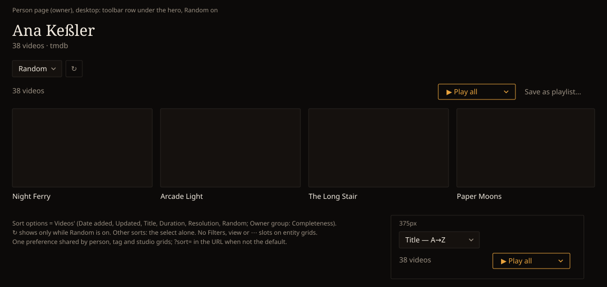

# Handoff Spec: Sort on entity video grids (HOLODEX-38)

**Story:** HOLODEX-38 (epic HOLODEX-13)
**Spec:** [`docs/specs/sort-persistence.md` SP6](../specs/sort-persistence.md#sp6--sort-on-an-entitys-video-grid-person-tag-studio--holodex-38)
· builds on the [F73 list toolbar handoff](list-toolbar-handoff.md)
**Date:** 2026-10-15 · **Status:** Layout and preference scope approved by the owner, 2026-10-15

Decided with the owner:
- **Layout A: browse's toolbar row, above the count line.** The rejected option put the sort inline
  in the count line. That saves a row, but it bypasses `ListToolbar` and wraps at 375px.
- **One sort preference for all entity grids.** Person, tag and studio grids share it, and Videos
  keeps its own. Rejected: a preference per entity kind, or sharing Videos' preference.

## Mockup

## Layout

Inside `EntityVideos`, between the `detail` snippet and the grid's count line:

1. `ListToolbar` with only the `sort` slot (and `reroll` while Random is on). It has no filters,
   view, actions or chips. The title filter stays in the nav search box (NS6).
2. The existing count line: `videoCount(matched)` on the left, and `PlaySplitButton` plus the
   owner's **Save as playlist…** on the right. It is unchanged.
3. `VideoGrid`, then **Load more**.

The toolbar renders whenever the grid does, including while it loads, so the select doesn't jump in
after the first page lands.

## Components

| Component | Use |
|---|---|
| `sort/ListToolbar` | Layout only. `sort` snippet; `reroll` set only when the sort is `random`. |
| `sort/SortDropdown` | `compact`, `owner={isOwner}`, the default `MEDIA_SORTS` options, `onchange` → the list controller's `setSort`. |
| `sort/SortReroll` | Rendered by the toolbar: ↻ "Shuffle again". |

No new component and no new styling. Everything is the F73 controls as browse renders them.

## States and interactions

- **Default** (`added_desc`): the select alone; no `?sort=` in the URL.
- **Any other sort**: the grid refetches from offset 0, and the URL gains `?sort=<value>` by
  replaceState, so no history entry is added.
- **Random**: ↻ appears beside the select. Pressing it rerolls the session seed, scrolls to the top
  and refetches. *Load more* pages under the same seed.
- **Owner-only sorts** (Completeness): listed in the select's "Owner" group for the owner only. A
  visitor's link carrying one falls back to the default.
- **Title filter typed in the nav box**: the sort holds and the debounce is unchanged.
- **← Back from a video**: the scroll snapshot is keyed by the sort, so it restores under the same
  sort and seed. A snapshot from another sort is dropped and the page opens at the top.
- **Play all / Shuffle / Save as playlist…**: carry `sort`, and `seed` while Random is on, so the
  run and the saved query follow the on-screen order.

## Responsive behaviour

At 375px the row holds the compact select (widest label "Resolution — highest", 20 characters, the
F73 budget) plus ↻. With no `⋯` on this toolbar, ↻ stays inline below `sm`.

## Accessibility

As F73: the select has an `sr-only` "Sort" label, and ↻ is a real button named "Shuffle again".

## Cinémathèque QA checklist

1. [agent] The select and ↻ use `border-rule`, `bg-surface` and `rounded-theme`; the accent shows
   only on focus or hover.
2. [agent] At 375px the toolbar row and the count line don't overflow.
3. [agent] Person, tag and studio pages each show the toolbar; a sort chosen on one is the starting
   sort on the others.
4. [human] Random → Load more → open a video → Back reopens the same shuffle at the same scroll.
