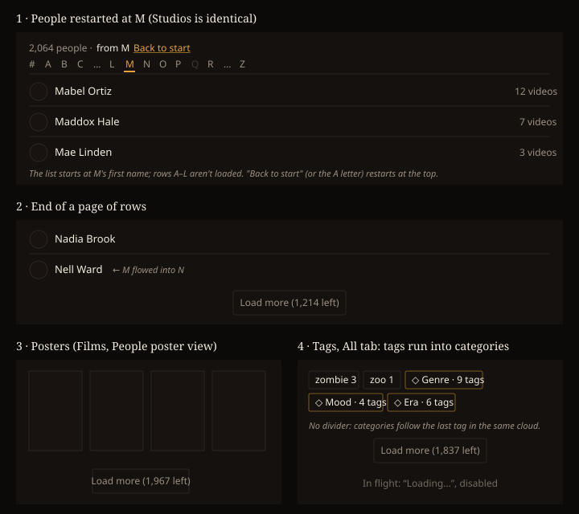

# Design handoff: paged entity lists (F80, HOLODEX-354)

**Approved by the owner 2026-10-18** (mockup below). Rules: [entity-list-paging.md](../specs/entity-list-paging.md)
(EL1–EL10). Sibling handoffs: [bounded picker search](bounded-picker-search-handoff.md) (HOLODEX-586),
[whole-list scroll](entity-list-virtual-scroll-handoff.md) (HOLODEX-601).

Tags and Films show one page and a Load more control, instead of every entry at once. **People and Studios
no longer use Load more:** since HOLODEX-601 they scroll the whole list, and their A–Z index scrolls to its
letter rather than restarting the list. That design is in the
[whole-list scroll handoff](entity-list-virtual-scroll-handoff.md), and it supersedes this doc's mockup panels
for those two pages. The look is unchanged except for the states below. Every new piece reuses a control the
app already has. Tokens only, in Cinémathèque ([theming.md](theming.md)).

## Load more (Tags and Films)

The control is the same one the Media grid and the entity video grids use (`entity/EntityVideos.svelte`):
- A centred row, `flex justify-center pt-4`, below the last entry.
- A `btn-ghost px-4 py-2 text-sm` button labelled **"Load more (N left)"**. N is the total minus the loaded
  count, with thousands separators.
- While a page is in flight the button reads **"Loading…"** and is `disabled`. The loaded entries stay put.
- Once everything is loaded the row is gone. A list that fits in one page never shows it.

| Page | Under |
|---|---|
| Films | the poster grid, full width |
| Tags | the pill cloud, full width |

The same control everywhere is deliberate: the owner learns one paging gesture.

**Failure.** A failed Load more keeps the loaded entries and shows the `text-sm text-warn` line above the
list, the same as `EntityVideos`. The button comes back so it can be retried.

## A–Z (People, Studios)

Moved to the [whole-list scroll handoff](entity-list-virtual-scroll-handoff.md#az-index). The active-letter
style (`text-accent font-medium`, a 2px `border-b-2 border-accent` underline, `aria-current="true"`) carries
over. The letter restart and the count line's "from M · Back to start" are withdrawn.

## Tags All tab

Categories follow the last tag in the **same** pill cloud: no divider, no heading, no second Load more.
Category pills keep their accent border and glyph, which is enough to tell them apart. N in "Load more
(N left)" counts tags and categories together on the All tab, and only its own kind on the Tags or
Categories tab.

The owner's "+ New" pill stays first in the cloud and is never paged.

## Search and Random

Nothing visible changes.
- On Tags, a search shows the first page of matches with its own Load more.
- "No … match “q”." is unchanged.
- The result count is the match total. On Tags it reads "N results for “q”".
- Random looks the same as it does today. Re-roll replaces the list with a fresh first page and scrolls to
  the top of the list.

## Back

Tags and Films come back with the same entries loaded, and then scroll. They never show a short list first
and then jump; they draw once at the restored size. (People and Studios: see the whole-list scroll handoff.)

## Accessibility

- **Load more.** It's a real `<button>`. Each finished page is announced in a polite live region:
  "Loaded 50 more. 1,164 left." When the last page lands and the button disappears, focus moves to the
  first newly added entry so it isn't stranded on `<body>`.
- **Focus order.** The entries, then Load more.

## Edge cases

| Case | Shows |
|---|---|
| Fewer entries than one page | no Load more |
| Tags Manage mode | selection persists across Load more; bulk actions apply to every selected pill |
| A delete, rename or create while pages are loaded | the loaded entries redraw in place at the same count; scroll is kept |
