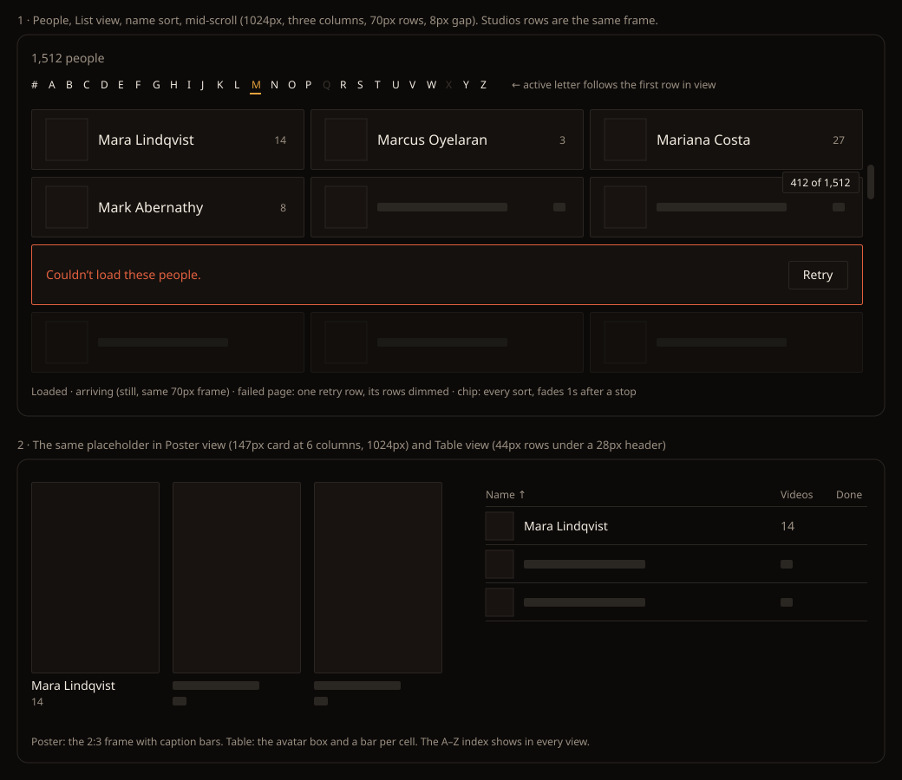

# Design handoff: whole-list scroll on People and Studios (F80, HOLODEX-601)

**Choices settled by the owner 2026-10-27** (mockup below): the position chip, still placeholders, one
retry row per failed page, A–Z in every People view, and an active letter that follows the scroll.
Rules: [entity-list-paging.md](../specs/entity-list-paging.md) (EL6, EL7, EL9, EL11–EL13). How it is
built: [stack.md, "Long lists"](../architecture/stack.md#long-lists-tanstack-virtuals-core-over-a-sparse-page-cache).
Sibling handoff: [paged entity lists](entity-list-paging-handoff.md) (Load more on Tags and Films).

People (List, Table and Poster) and Studios become one list as tall as the whole library, under every
sort and search. Load more leaves these two pages. Everything else on them looks the same: the
toolbar, the count line ("1,512 people"), the rows and cards, and the A–Z index. Tokens only, in
Cinémathèque ([theming.md](theming.md)).

## The scroll

- The page's own scrollbar spans the whole list. There is no inner scroll box, so the toolbar and
  the A–Z bar stay sticky as they are today.
- On a sort, search or Random re-roll, the list returns to the top.
- On a view change (List, Table, Poster), the first entry in view stays in view.

## Fixed row heights (the contract)

Every row in a view has one height, so the list's length is known before any entry arrives. Measured
on the stress fixture at 1024px:

| View | Row | Lanes |
|---|---|---|
| People List, Studios | 70px row (`py-2.5`, 48px avatar or logo box), 8px gap | 1 / 2 / 3 at base / `sm` / `lg` |
| People Poster | `PersonPosterCard`: a 2:3 frame plus a two-line caption (name `line-clamp-1`, count). 147 × 264px at 6 columns | `posterColumns()` (density) |
| People Table | 44px body row under a 28px header | 1 |

The row markup already holds to this: names truncate on one line, and the avatar, logo box and ring
are fixed sizes. **Nothing in a row may wrap.** A row that grows is a bug to fix in the row, not a
case for the list to measure.

## Placeholders

A placeholder is the row's own frame at its full size, with no data and no motion:

- **List and Studios:** `bg-surface` with a `border-rule` border. The 48px avatar or logo box is
  `bg-surface-2`, a 10px `bg-rule` bar stands in for the name, and a short bar stands in for the
  count. There is no ring.
- **Poster:** the 2:3 frame in `bg-surface-2` with a `border-rule` border, then two caption bars. No
  image is requested until the entry arrives.
- **Table:** the 32px avatar box and a bar in each cell.

Placeholders are still. There is no pulse or shimmer: a page usually fills within half a second, and
a screen of pulsing rows reads as busy. Each placeholder carries `aria-busy="true"`. When the entry
arrives it replaces the placeholder in the same box, so nothing moves.

## A page that fails

- The first grid row lying wholly inside the failed page becomes a **retry row**. That's the row of
  the page's first entry when it starts a row, or the next row when it doesn't, so the row never
  covers a neighbouring page's loaded entries. A 50-entry page always holds a full row, even at the
  widest poster density. The retry row spans every lane and keeps the row height, so nothing shifts. It has a `border-warn` border, the text
  "Couldn’t load these people." (or "these studios.") in `text-sm text-warn`, and a
  `btn-ghost px-3 py-1.5 text-sm` **Retry** button at the right.
- The rest of that page's rows stay placeholders, dimmed (`opacity-55` on the frame, which is
  decorative, never on text) and still.
- Retry re-fetches that page only. The rest of the list keeps scrolling and loading.
- If the whole first load fails, today's centred "Couldn’t load people: …" message stays as it is.

## Position chip

A small chip beside the scrollbar says where you are: **"412 of 1,512"**, the position of the first
entry in view and the total, with thousands separators.

- It shows while the list scrolls, in every sort and in search results, and fades out 1s after
  scrolling stops (instantly under `prefers-reduced-motion`).
- `fixed`, vertically aligned with the scrollbar thumb's position, `right-3` from the viewport edge.
  `bg-surface border border-rule rounded-theme px-2 py-1 text-xs text-ink`.
- It is decorative (`aria-hidden="true"`): a screen reader already hears each row's position (see
  Accessibility).
- Hidden below `sm`, where the A–Z rail sits on that edge and touch scrollbars are overlays.

## A–Z index

`entity/AlphaIndex.svelte`, the sticky bar from `sm` up and the right-edge rail below `sm`, as today.

- **Shows** on the name sort with no search, in **every People view (List, Table and Poster)** and on
  Studios. Poster view gains it.
- **Active letter follows the scroll.** It's the letter of the first entry in view, in the existing
  active style (`text-accent`, a 2px `border-accent` underline, `aria-current="true"`). It updates
  as you scroll, without announcing.
- **Clicking a letter** scrolls so that letter's first entry sits just under the sticky bars, with
  smooth scrolling unless `prefers-reduced-motion` is set. Focus moves to that entry's row. Its
  placeholder takes focus if it hasn't arrived yet.
- Dimmed letters (no names in the library) stay inert and `aria-hidden`.
- **Withdrawn:** the count line's "· from M · Back to start" suffix. Nothing restarts, so there's
  nothing to go back from. Scrolling up, or clicking A or `#`, reaches the start.

## Count line, select mode, Back

- **Count line:** unchanged, "N people" / "N studios", the library or match total.
- **Merge select mode (People):** looks as it does today. Selected people stay selected when they
  scroll out of view and back, and "N selected" counts all of them. Entering select mode still
  switches to List view, which keeps the first entry in view.
- **Back:** the page comes back at the same entry in view, with placeholders at once and entries
  filling in place. It never draws the top of the list first and then jumps.

## Accessibility

- **One tab stop.** The list is a single Tab stop with roving tabindex. Tab enters on the last
  focused entry, or the first in view, and Tab again leaves the list for whatever follows it.
- **Keys:** ↑/↓ move one row of lanes. ←/→ move one entry in multi-lane views. Home/End go to the
  first and last entry of the whole list. PageUp/PageDown move a screen. Enter opens the entry. In
  select mode, Space toggles its checkbox. The focused row stays drawn while it is off screen.
- **Screen reader:** each List, Poster or Studios row is a list item announced with its position
  ("Mara Lindqvist, 412 of 1,512"). Table rows announce their row number out of the total. A
  placeholder is announced as busy.
- **Focus ring:** unchanged (`has-[a:focus-visible]:border-accent` on rows, the card's
  `poster-card` focus-lift). It now keys off the row element that carries the roving tabindex.

## Edge cases

| Case | Shows |
|---|---|
| A list shorter than the viewport | the list ends after its last row; no chip (there's nothing to scroll) |
| Drag from top to bottom in one motion | placeholders the whole way; only the stop's pages fetch |
| Search with no match | today's "No people match “q”." |
| A merge, delete or create while deep in the list | the same entry stays in view; rows in view redraw in place; a changed total shortens or lengthens the scrollbar |
| A refresh sweep finishing | as a mutation: rows in view redraw, scroll kept |
| A–Z letter whose first entry is near the end | scrolls as far as the list allows; that entry is in view and focused, though not at the top |
| Resize across a breakpoint, or a density change in Poster | lanes and row height recompute; the first entry in view stays in view |
