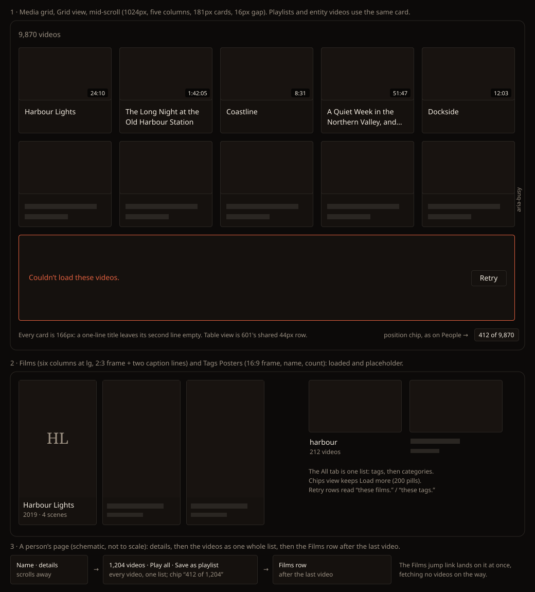

# Design handoff: whole-list scroll (F80, HOLODEX-601 · HOLODEX-604)

**Choices settled by the owner 2026-10-27** (mockup below): the position chip, still placeholders, one
retry row per failed page, A–Z in every People view, and an active letter that follows the scroll.
Rules: [entity-list-paging.md](../specs/entity-list-paging.md) (EL6, EL7, EL9, EL11–EL13). How it is
built: [stack.md, "Long lists"](../architecture/stack.md#long-lists-tanstack-virtuals-core-over-a-sparse-page-cache).
Sibling handoff: [paged entity lists](entity-list-paging-handoff.md) (Load more on Tags and Films).

People (List, Table and Poster) and Studios become one list as tall as the whole library, under every
sort and search. Load more leaves these two pages. Everything else on them looks the same: the
toolbar, the count line ("1,512 people"), the rows and cards, and the A–Z index. Tokens only, in
Cinémathèque ([theming.md](theming.md)).

## The scroll

- The page's own scrollbar spans the whole list. There is no inner scroll box, so the A–Z bar
  stays sticky as it is today (the toolbar scrolls away with the page, as today).
- On a sort, search or Random re-roll, the list returns to the top.
- On a view change (List, Table, Poster), the first entry in view stays in view.

## Fixed row heights (the contract)

Every row in a view has one height, so the list's length is known before any entry arrives. Measured
on the stress fixture at 1024px:

| View | Row | Lanes |
|---|---|---|
| People List, Studios | 70px row (`py-2.5`, 48px avatar or logo box), 8px gap | 1 / 2 / 3 at base / `sm` / `lg` |
| People Poster | `PersonPosterCard`: a 2:3 frame plus a two-line caption (name `line-clamp-1`, count). 147 × 264px at 6 columns | `posterColumns()` (density) |
| People Table | 44px body row under a 28px header | 1 |

The row markup already holds to this: names truncate on one line, and the avatar, logo box and ring
are fixed sizes. **Nothing in a row may wrap.** A row that grows is a bug to fix in the row, not a
case for the list to measure.

## Placeholders

A placeholder is the row's own frame at its full size, with no data and no motion:

- **List and Studios:** `bg-surface` with a `border-rule` border. The 48px avatar or logo box is
  `bg-surface-2`, a 10px `bg-rule` bar stands in for the name, and a short bar stands in for the
  count. There is no ring.
- **Poster:** the 2:3 frame in `bg-surface-2` with a `border-rule` border, then two caption bars. No
  image is requested until the entry arrives.
- **Table:** the 32px avatar box and a bar in each cell.

Placeholders are still. There is no pulse or shimmer: a page usually fills within half a second, and
a screen of pulsing rows reads as busy. Each placeholder carries `aria-busy="true"`. When the entry
arrives it replaces the placeholder in the same box, so nothing moves.

## A page that fails

- The first grid row lying wholly inside the failed page becomes a **retry row**. That's the row of
  the page's first entry when it starts a row, or the next row when it doesn't, so the row never
  covers a neighbouring page's loaded entries. A 50-entry page always holds a full row, even at the
  widest poster density. The retry row spans every lane and keeps the row height, so nothing shifts. It has a `border-warn` border, the text
  "Couldn’t load these people." (or "these studios.") in `text-sm text-warn`, and a
  `btn-ghost px-3 py-1.5 text-sm` **Retry** button at the right.
- The rest of that page's rows stay placeholders, dimmed (`opacity-55` on the frame, which is
  decorative, never on text) and still.
- Retry re-fetches that page only. The rest of the list keeps scrolling and loading.
- If the whole first load fails, today's centred "Couldn’t load people: …" message stays as it is.

## Position chip

A small chip beside the scrollbar says where you are: **"412 of 1,512"**, the position of the first
entry in view and the total, with thousands separators.

- It shows while the list scrolls, in every sort and in search results, and fades out 1s after
  scrolling stops (instantly under `prefers-reduced-motion`).
- `fixed`, vertically aligned with the scrollbar thumb's position, `right-3` from the viewport edge.
  `bg-surface border border-rule rounded-theme px-2 py-1 text-xs text-ink`.
- It is decorative (`aria-hidden="true"`): a screen reader already hears each row's position (see
  Accessibility).
- Hidden below `sm`, where the A–Z rail sits on that edge and touch scrollbars are overlays.

## A–Z index

`entity/AlphaIndex.svelte`, the sticky bar from `sm` up and the right-edge rail below `sm`, as today.

- **Shows** on the name sort with no search, in **every People view (List, Table and Poster)** and on
  Studios. Poster view gains it.
- **Active letter follows the scroll.** It's the letter of the first entry in view, in the existing
  active style (`text-accent`, a 2px `border-accent` underline, `aria-current="true"`). It updates
  as you scroll, without announcing. After a click it's the clicked letter: in a multi-lane view a
  letter's first name often sits mid-row, after the last names of the letter before, so the row's
  first entry would otherwise light the wrong letter.
- **Clicking a letter** scrolls so that letter's first entry sits just under the sticky bars. It
  glides within two screens unless `prefers-reduced-motion` is set; a farther jump is instant,
  because a glide across thousands of rows shows only placeholders and takes over a second. Focus moves to that entry's row. Its
  placeholder takes focus if it hasn't arrived yet.
- Dimmed letters (no names in the library) stay inert and `aria-hidden`.
- **Withdrawn:** the count line's "· from M · Back to start" suffix. Nothing restarts, so there's
  nothing to go back from. Scrolling up, or clicking A or `#`, reaches the start.

## Count line, select mode, Back

- **Count line:** unchanged, "N people" / "N studios", the library or match total.
- **Merge select mode (People):** looks as it does today. Selected people stay selected when they
  scroll out of view and back, and "N selected" counts all of them. Entering select mode still
  switches to List view, which keeps the first entry in view.
- **Back:** the page comes back at the same entry in view, with placeholders at once and entries
  filling in place. It never draws the top of the list first and then jumps.

## Accessibility

- **One tab stop.** The list is a single Tab stop with roving tabindex. Tab enters on the last
  focused entry, or the first in view, and Tab again leaves the list for whatever follows it.
- **Keys:** ↑/↓ move one row of lanes. ←/→ move one entry in multi-lane views. Home/End go to the
  first and last entry of the whole list. PageUp/PageDown move a screen. Enter opens the entry. In
  select mode, Space toggles its checkbox. The focused row stays drawn while it is off screen.
- **Screen reader:** each List, Poster or Studios row is a list item announced with its position
  ("Mara Lindqvist, 412 of 1,512"). Table rows announce their row number out of the total. A
  placeholder is announced as busy.
- **Focus ring:** unchanged (`has-[a:focus-visible]:border-accent` on rows, the card's
  `poster-card` focus-lift). It now keys off the row element that carries the roving tabindex.

## Edge cases

| Case | Shows |
|---|---|
| A list shorter than the viewport | the list ends after its last row; no chip (there's nothing to scroll) |
| Drag from top to bottom in one motion | placeholders the whole way; only the stop's pages fetch |
| Search with no match | today's "No people match “q”." |
| A merge, delete or create while deep in the list | the same entry stays in view; rows in view redraw in place; a changed total shortens or lengthens the scrollbar |
| A refresh sweep finishing | as a mutation: rows in view redraw, scroll kept |
| A–Z letter whose first entry is near the end | scrolls as far as the list allows; that entry is in view and focused, though not at the top |
| Resize across a breakpoint, or a density change in Poster | lanes and row height recompute; the first entry in view stays in view |

## The other library lists (HOLODEX-604)

**Owner choices 2026-10-28:** a two-line title box on every video card, the Films row kept below the
videos on entity pages, and tag pages included. Rules: spec EL11, EL14 and EL15.

Everything above holds for these lists too: the page's own scrollbar, fixed row heights, still
placeholders, one retry row per failed page, the position chip, one Tab stop with roving tabindex,
and Back to the same entry. Only what differs is listed here. None of them shows A–Z.

### Fixed row heights, continued

| List | Row | Lanes |
|---|---|---|
| Media grid, playlist, entity videos (Grid) | `VideoCard`: the `.video-frame` (16:9, or 2:3 under `card_layout: poster`) plus a `p-3` caption whose title box is **always two lines** (`h-10` on the `text-sm` title, `line-clamp-2`). 181 × 166px at five columns, 16px gap | `effectiveDensity()`, capped by width as today (`VideoGrid`) |
| Media grid (Table) | the shared 44px `ListTable` row, as People Table | 1 |
| Films | the 2:3 frame plus `p-2` holding a `truncate` name and the year · scenes line. 151 × 281px at six columns, 12px gap | 2 / 3 / 4 / 6 at base / `sm` / `md` / `lg` |
| Tags Posters | the `aspect-video` frame, a `line-clamp-1` name and the count line | `effectiveDensity()` |
| Tags Table | the shared 44px `ListTable` row | 1 |

**The two-line title box is the one visible change to the video card.** A one-line title leaves the
second line empty, and a title longer than two lines ends in an ellipsis with the full title in its
`title` tooltip, as today. It applies to every `VideoGrid`, the film's Scenes grid included, so a
card is the same size everywhere. `RelatedShelf` cards take the same box, since they share the card.

### Placeholders, continued

- **Video card:** the `.video-frame` in `bg-surface-2` with its `border-rule` border, then two
  10px `bg-rule` bars in the title box (about 80% and 50% of the caption's width). No badges, no
  ring, no thumbnail request.
- **Films:** the 2:3 frame in `bg-surface-2`, then a 10px bar for the name and an 8px bar for the
  year line.
- **Tags Posters:** the 16:9 frame in `bg-surface-2`, then a name bar and a count bar.
- **Tables:** the 601 table placeholder.

### Retry row copy

"Couldn’t load these videos." (Media grid, playlist, entity videos) · "these films." · "these tags."
(on the All tab, "these tags." for categories too). Same markup as People.

### Media grid

- The **Recently added** shelf stays above the toolbar, unchanged.
- The grid's arrow-key navigation becomes the roving list's key map (↑/↓ a row of lanes, ←/→ an
  entry, Home/End, PageUp/PageDown, Enter). `/` still focuses search.
- **Back** shows the videos seen just before leaving at once, then fills the rest in place. It never
  shows the top of the grid first.
- A finished scan redraws the cards in view in place; the count line and scrollbar adjust.
- The smart-playlist edit mode (`#edit_playlist`) keeps its own controls above the grid, unchanged.

### Playlist

- Smart and snapshot alike. The owner's **×** on a snapshot card stays where it is (top-right,
  sibling of the card's link). Removing a card closes the gap at once; the cards after it move up
  one place, and the scroll doesn't move.
- The stale-references notice replaces the list, as today.

### Tags Posters and Table

- All, Tags and Categories tabs each scroll as one list; on All, categories follow the last tag with
  no break or heading, as in today's stream.
- **Manage mode:** the per-entry ⋯ menu opens over neighbouring rows, never clipped by its row, and
  closes when its entry scrolls out of the drawn range. The focused entry stays drawn while its menu
  is open.
- Bulk select stays in Chips.

### Videos on a person's, studio's or tag's page

- The list sits in the page below the details and the section toolbar, so it starts lower than on
  People. The page scrolls as one; there is no inner scroll box.
- The **position chip** shows only while the videos list is in view and scrolling, and reads
  "412 of 1,204", the section's own total.
- The **Films row** follows the last video. Its `#films` link (and the hover card's Films link) lands
  on its heading at once, 64px below the top, with placeholders above it and no videos fetched on
  the way. `#videos` lands on the section's count line.
- Back restores the same video in view, as on People.

### Edge cases, continued

| Case | Shows |
|---|---|
| A playlist or entity with fewer videos than one screen | the list ends after its last card; the Films row follows directly; no chip |
| A card layout switch (`card_layout`) or density change | row height recomputes from the new frame; the first entry in view stays in view |
| A video title of one character, or 1,500 | the same 166px card at five columns: one line and an empty line, or two lines and an ellipsis |
| Snapshot playlist removal of the last card in view | the next card moves up; if the playlist empties, today's empty state |
| Jump to `#films` on a person with 10,000 videos | Films heading at once; the videos above stay placeholders until scrolled to |
