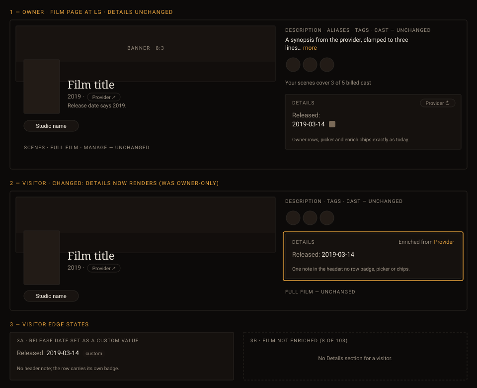

# Handoff Spec: Film Details parity (HOLODEX-95)

**Story:** HOLODEX-95 (epic HOLODEX-20, Unified metadata presentation)
**Spec:** [`docs/specs/film-provider-enrichment-ux.md`](../specs/film-provider-enrichment-ux.md) (F59)
· mechanism: [`entity-relationships.md`](../architecture/entity-relationships.md) (film enrichment
vocabulary) · reference pattern: [studio Details §2c](studio-entity-handoff.md)
**Date:** 2026-10-16 · **Status:** Option (a) approved by the owner, 2026-10-16

Decided with the owner:
- **The film page's Details section is the studio page's Details section.** Same rows, same
  owner/visitor branches, same section-level provenance note. The film page stops being the one
  entity page with bespoke field markup.
- **Runtime, tagline and genres are film fields**, not display-only extras. Rejected: making the
  field registry per-entity so they arrive as read-only "Additional details" rows — the owner would
  get only Promote/Attach instead of the source picker, and genres would render as plain text.
- Folded in from the design critique: runtime's unit rides its label ("Runtime (min)"); no
  "Original title" row (it already lands in Aliases); genres are outline value chips, never the
  filled, linked tag chips.

## Mockup

## Layout

Only the rail's Details section changes. Header, Description, Aliases, Tags, Cast, billed-cast
coverage, Full film, Manage and the Scenes grid are untouched and keep their order.

Details keeps its slot (after billed-cast coverage, before Full film) and its box:
`section space-y-3 rounded-theme border border-rule bg-surface p-4`. Inside, one
`<dl class="grid grid-cols-1 gap-3 text-sm sm:grid-cols-2">`, filled in the studio page's order:

1. **Compact rows** — single-value fields: Released, Runtime (min), Tagline.
2. **Long rows** — single-value fields whose display is long text; span both columns.
3. **Merge rows** — multi-value fields: Genres. Span both columns.
4. **Additional details** — `AutoFieldRows` closes the list: the "Additional details" divider and
   any non-canonical key a provider sent for this film. TMDB sends none today, so for most films
   this group is absent.

Name and description stay out of Details; they keep their own header and rail sections.

## Components

| Component | Where | Props / notes |
|---|---|---|
| `SourceBadge` | owner, compact and long rows | Same call as studio (`baselineKey="record"`); badge opens the source picker; Custom writes a film field decision |
| `ProvenanceBadge` | visitor rows, multi-provider case only | Follows the inline value; omitted when the section note is shown |
| `CurationFieldRow` | Genres (owner and visitor) | `curate` / `clearCuration` bound to the film's curation calls, `showWriteToggle={false}` (as on studio), `isOwner` |
| `PromotedFieldEdit` | after each row | Same per-row snippet as studio; renders only for promoted fields |
| `AutoFieldRows` | end of the list | `fields={extraFields} {isOwner} entityType="film" entityNoun="films" onchanged={reloadDetail}` |
| `EnrichProviderChips` / `NoProviderHint` | owner header | Unchanged |
| Visitor header note | visitor header, single provider | `text-xs text-muted` "Enriched from **{Provider}**", provider name `text-accent` — the studio page's markup |

Row markup is the studio page's, verbatim:
- Owner compact row: `dt.mb-1 text-muted "Label:"` over a `dd` holding the `SourceBadge`.
- Visitor compact row: inline `dt.text-muted`, `dd.inline text-ink`.
- Long rows (visitor): `dd.mt-1 block leading-relaxed text-ink`.

Genre chips are `CurationChip`s inside `CurationFieldRow`: `rounded-full border px-2 py-0.5
text-xs`, no fill. They are not links. Tag chips (`TagLinkChip`, filled `bg-surface-2`, linked) stay in the Tags
section only.

## States and interactions

| Element | State | Behaviour |
|---|---|---|
| Details section | owner, no values, sources not loaded | Hidden (as today) |
| Details section | owner, sources loaded | Shown with every film field that has a value or a candidate |
| Details section | visitor | Shown when at least one row has a value; hidden otherwise. Previously never shown |
| Section note | visitor, every row from one provider | "Enriched from {Provider}" in the header; rows carry no badge |
| Section note | visitor, rows from two or more providers, or any file/custom value | No note; each row carries its `ProvenanceBadge` (mockup panel 3a) |
| Runtime / Tagline / Released | owner, badge click | Source picker expands in place (radio chips, Custom, Confirm, Cancel) — `SourceBadge`'s existing behaviour |
| Genres | owner, `+ Add` | Inline input (`input w-28 … text-xs`); Enter adds, Escape cancels |
| Genres | owner, chip controls | Each chip's existing edit (inline) and remove (suppress) controls, unchanged from the studio page |
| Genres | visitor | Read-only chips, no Add, no edit or remove controls |
| Additional details row | owner | Promote / Attach pills, as on studio (panel 3b) |
| Additional details row | visitor | Read-only row |
| Any write | error | `text-xs text-warn` under the row (existing component behaviour) |
| Any write | success | `onchanged` reloads the film detail; the row re-renders with its new badge |

Rows never shown on a film: Original title, Director, Actors, Studio, Homepage, Status, Original
language. Why, and which of the last three may come later (HOLODEX-579), is in the spec.

## Responsive behaviour

| Breakpoint | Changes |
|---|---|
| `lg` and up | `stage-grid` two columns; Details sits in the rail (`minmax(320px,1fr)`), `dl` is two columns from `sm` |
| below `lg` | Single column; Details follows the subject column in rail order. `dl` stays two columns from `sm`, one below |
| 375px | One column; genre chips wrap; the Add pill wraps with them |

## Edge cases

- **One field only** (release date): the section still renders, one row. Visitor sees the note.
- **Many genres** (10+): chips wrap; no truncation, no "more" — the studio merge rows don't truncate either.
- **Long tagline:** wraps; `wrap-anywhere` from `SourceBadge`. No clamp.
- **Runtime value not a number** (provider sent text): shown as sent; the label still says "(min)".
- **No provider configured:** owner sees `NoProviderHint` and file/record rows only; visitor sees
  the rows without a note.
- **Loading:** no skeleton; the section appears when the detail payload arrives, as today.

## Animation / motion

None added. Source picker expand/collapse and curation Undo keep their existing behaviour.

## Accessibility

- Focus order: Details heading → each row's badge (owner) in DOM order → each genre chip's edit
  and remove controls → Add → Additional details pills. Visitor rows have no focus stops except links inside values.
- `dt`/`dd` pairs keep the list semantic; the visitor note is plain text in the section header.
- Provider icons in `ProvenanceBadge` keep their existing accessible names.
- Known gap, not fixed here: Promote/Attach pills are ~22px tall, under the WCAG 2.2 24px target
  (shared component, HOLODEX-580).

## Cinémathèque QA checklist

1. [agent] Owner film page: Details shows Released, Runtime (min), Tagline, Genres with provider badges; genre chips are outline, not filled.
2. [agent] Visitor film page (single provider): Details renders with "Enriched from TMDB" and no per-row badges, pencils, Add or chip controls.
3. [agent] Visitor film page, mixed sources: no header note; each row has its badge.
4. [agent] Visitor film page with no values: no Details section.
5. [agent] Genres add / remove as owner round-trips and never creates a tag (Tags section unchanged).
6. [agent] No Original title, Director, Actors or Studio row on any film.
7. [human] Side by side with a studio page: Details rows, spacing and note read identically.
8. [smoke] 375px: chips wrap, no horizontal scroll.
