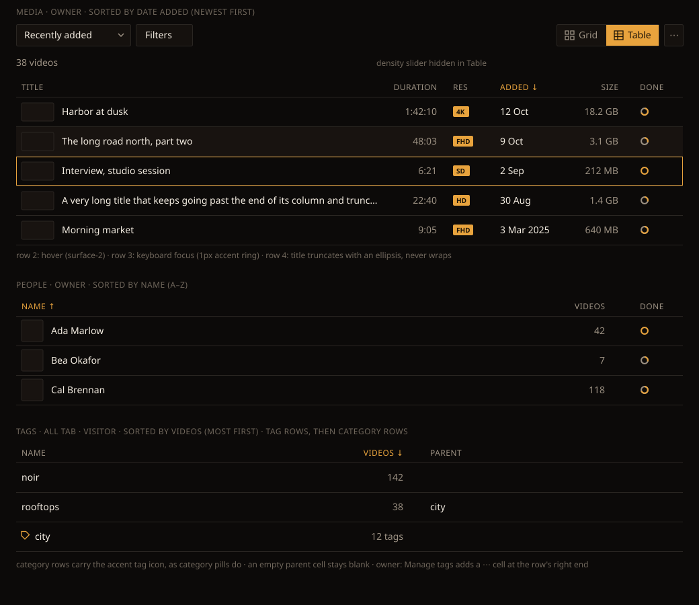
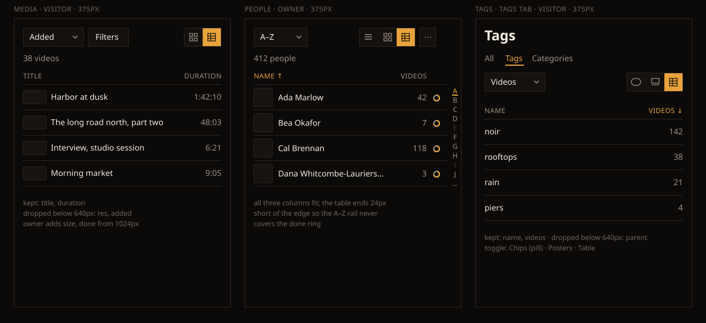
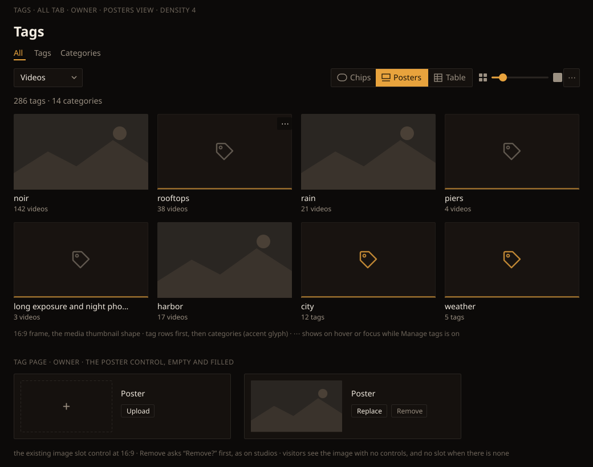

# Handoff Spec: List views — the shared Table view and Tags Posters (F82)

**Epic:** HOLODEX-32 (with HOLODEX-42, HOLODEX-46)
**Spec:** [`docs/specs/list-views.md`](../specs/list-views.md) · builds on the
[list toolbar handoff](list-toolbar-handoff.md) (F73)
**Date:** 2026-10-24 · **Status:** Draft, awaiting owner sign-off at `/implement`

Decided with the owner on 2026-10-24, from side-by-side mockups:
- **Hairline rows, not bordered row cards.** These are 44px rows separated by a rule line, the
  pattern the app's existing tables use. Bordered 56px rows showed about 30% fewer rows per screen,
  and dense lists read better without a card per row.
- **A tag with no image shows a tag glyph**, drawn like the person silhouette: a `surface-2` field,
  a muted glyph and the accent baseline. Setting the tag's name large was rejected because it
  repeats the caption under the card.
- **Tag posters use the 16:9 media thumbnail frame**, not People's 2:3 portrait. Tags are about
  what's in the videos, so their pictures are frames from video. The view keeps the name
  **Posters**, which the spec uses.

## Mockups

These use the real `app.css` tokens and existing component classes. Text was measured in a browser:
no label overflows its control, and long names truncate as shown.

**Desktop:** Media (owner), People (owner) and Tags (visitor, All tab) in the Table view. The
mockup also shows the hover, focus and truncation states:

**375px:** each page with its narrow column set, and People with the A–Z rail:

**Tags Posters and the tag page control:** the All tab in Posters view (owner), and the poster
control on a tag's page, empty and filled:

## Overview

The list toolbar's View slot (F73) gets one more view on People and gains choices on Media and
Tags. One shared table renders the Table view on all three pages, and each page supplies only its
column list. Tags also gets a Posters view, which needs the poster control on the tag's own page.
Behaviour and acceptance are in the [spec](../specs/list-views.md). This doc covers what the owner
sees and touches.

## View slot

| Page | Choices, in order | Default | Density slider |
|---|---|---|---|
| Media | Grid · Table | Grid | Grid only |
| People | List · Poster · Table | List | Poster only (unchanged) |
| Tags | Chips · Posters · Table | Chips | Posters only |

- **One segmented control for all three pages.** `PersonViewToggle` becomes a generic
  `ViewToggle` that takes the page's choices, using the same classes:
  `segmentedToggle.ts` wrapper, cells `inline-flex h-8 w-8 items-center justify-center
  sm:w-auto sm:px-3`, active `bg-accent text-accent-ink`, inactive `text-muted hover:text-ink`.
  It stays a group of `aria-pressed` buttons, as People's toggle is today.
- **Icons:** inline SVGs, 14px (`h-3.5 w-3.5`), drawn with the same 1.3–1.5 stroke as today's:
  - **List**: unchanged (three lines).
  - **Poster** and **Grid**: unchanged (the outlined 2×2).
  - **Table**: a 13px square split by two horizontal rules and one vertical rule near the left.
  - **Chips**: a 16×12 pill outline.
  - **Posters (Tags)**: a 14×8 frame over a 14px baseline.
- **Labels from `sm` up, icons only below.** Below `sm` each cell carries `aria-label` ("Table",
  "Chips"…), as People's does today.

## The Table view

### Structure

- **A real `<table>`**, built by one new component, `ListTable`. A page passes it an ordered
  column list. Each column gives:
  - its header label;
  - its alignment;
  - an optional sort key;
  - a priority;
  - whether it is owner-only;
  - a cell snippet.
- **The whole row is the link.** The first cell holds the item's `<a>`, stretched over the row with
  the same stretched-link pattern People's List rows use. Other cells are text. When Manage tags is
  on, the ⋯ cell sits above the stretch (`relative z-10`).
- **Paging is unchanged.** The page's existing Load more button (F80) goes under the table. New
  rows are appended into the same `<tbody>`, so nothing jumps, and focus moves to the first new
  row's link, as Load more already does for pills and cards.

### Tokens and classes

| Element | Classes | Notes |
|---|---|---|
| table | `w-full table-fixed text-left text-sm` | `table-fixed` with set column widths, so a long title can't widen the table |
| header row | `border-b border-rule` | |
| header cell | `px-2 py-1.5 text-xs font-medium uppercase tracking-wide text-muted` | the style JobHistory already uses |
| active sort header | `text-accent` + ` ↑` / ` ↓` | the arrow is text, so it inherits the colour |
| sortable header | a `<button>` filling the cell, `hover:text-ink`, focus `ring-1 ring-accent` | plain text when the column has no sort key |
| body row | `h-11 border-b border-rule` (44px) | |
| row hover | `bg-surface-2` | |
| row keyboard focus | `ring-1 ring-inset ring-accent` on the row (`:has(a:focus-visible)`) | |
| body cell | `px-2 truncate` (`whitespace-nowrap overflow-hidden text-ellipsis`) | text never wraps |
| primary cell text | `text-ink` | title, name, date |
| numeric cell | `text-right tabular-nums text-muted` | duration, size, counts |

### Columns

The width figures are desktop `<col>` widths. The **keep below** figure is the narrowest width at
which the column still shows.

**Media**
| Column | Cell | Align | Width | Keep below | Visitor |
|---|---|---|---|---|---|
| Title | 48×27 thumbnail (`rounded-theme bg-surface-2 border-rule`, 40×23 below `sm`), then title | left | auto | always | yes |
| Duration | `formatDuration` | right | 9% | always | yes |
| Res | the existing resolution badge (`bg-accent text-accent-ink text-[10px]`, `4K`/`FHD`/`HD`/`SD`) | left | 7% | `sm` (640px) | yes |
| Added | `shortDate` ("12 Oct", or "3 Mar 2025" in another year) | left | 13% | `sm` | yes |
| Size | `formatBytes` | right | 10% | `lg` (1024px) | owner only |
| Done | CompletenessRing `size="card"` (14px) | left | 6% | `lg` | owner only |

**People**
| Column | Cell | Align | Width | Keep below | Visitor |
|---|---|---|---|---|---|
| Name | 32px square avatar (`PersonAvatar`, `w-8`), then name | left | auto | always | yes |
| Videos | count | right | 12% | always | yes |
| Done | CompletenessRing 14px | left | 8% | always | owner only |

**Tags**
| Column | Tag row | Category row | Align | Keep below |
|---|---|---|---|---|
| Name | name | 14px accent tag icon (as on the category pill), then name | left | always |
| Videos / tags | video count | "12 tags" | right | always |
| Parent | parent tag's name, blank when there is none | blank | left | `sm` |
| ⋯ | owner menu, only while Manage tags is on | none | right, 40px | always |

The All tab shows tag rows, then category rows, in the same order the Chips view loads them.

### At 375px

- **Media keeps title and duration.**
- **People keeps all three columns.** The table gets `pr-6` so the fixed A–Z rail (`right-1`)
  never covers the Done ring. Below `sm` the rail shows whenever it already would in List view:
  name sort, no search query.
- **Tags keeps name and videos.**
- There is no horizontal scroll anywhere. Truncation absorbs the extra length.

## Tags Posters view

- **Grid:** the media grid's column rules and the shared density value, the same as People's
  Poster view.
- **Card:** a 16:9 frame (`aspect-video rounded-theme overflow-hidden`), then
  `line-clamp-1 pt-1.5 text-sm font-medium text-ink` for the name, then `text-xs text-muted` for
  "142 videos" or "12 tags".
- **Hover and focus:** the poster card's existing ring and lift (`app.css` poster card).
- **Placeholder, tag:** a `surface-2` field, the tag glyph at 28px in `muted` at 0.55 opacity, a 3px
  accent baseline at 0.6 opacity, and a 1px `rule` frame at 0.5 opacity. It mirrors the person
  silhouette.
- **Placeholder, category:** the same frame with the glyph in `accent` at 0.8 opacity. That makes
  categories distinguishable at a glance, as the accent-bordered category pills are.
- **Owner ⋯:** while Manage tags is on, each card shows a 26×22 `bg-bg/80` ⋯ button in the
  top-right corner on hover or focus-within. It opens the same menu the pill's ⋯ opens. Bulk
  select stays in Chips (spec P0-8).

## Tag page: the poster control

- **The existing `EntityImageSlot`**, unchanged, with a 16:9 image box (160×90) and the label
  "Poster".
- **Empty, owner:** the dashed ghost slot with a centered "+", and an "Upload" button.
- **Filled, owner:** the image, plus "Replace" and "Remove". Remove asks "Remove?" first, exactly as
  on studios.
- **Visitor:** the image with no controls. With no image, the slot isn't rendered at all.
- **Placement:** in the tag page's header area, beside the existing owner controls. It sits where
  the studio page puts its image slots.

## States

| Element | State | Behaviour |
|---|---|---|
| Table row | hover | `bg-surface-2`, cursor pointer |
| Table row | keyboard focus | 1px inset accent ring |
| Sortable header | hover | `text-ink` |
| Sortable header | click on another column | that column becomes the Sort select's choice, the URL `sort` updates |
| Sortable header | click on the active column | the direction flips, if Sort has both directions; otherwise nothing happens |
| Table | loading first page | 8 skeleton rows at 44px (`bg-surface-2` bars, the existing shimmer) |
| Table | loading next page | the Load more button's existing "Loading…" state |
| Table | no results | the page's existing empty message; no header row |
| Table | error | the page's existing error banner |
| Posters card | image loading | the media card's shimmer in the 16:9 frame |
| Posters card | image fails | falls back to the placeholder |
| Poster control | uploading | the slot's existing busy state |
| Poster control | upload refused | the slot's existing error line under the buttons |

## Edge cases

- **Long titles and names** truncate with an ellipsis on one line, in every cell.
- **No resolution** (width 0): the Res cell is blank, the same rule the card uses.
- **A tag with no parent:** a blank cell. Never "None" and never a dash.
- **Huge counts:** tabular figures, right-aligned, with no thousands separator, as everywhere else.
- **Switching views keeps scroll at the top.** The rows are different heights, so the restore is
  F73's per-view behaviour.

## Motion

None beyond what exists: the row hover uses the app's existing `transition-colors`. View switches
swap the content with no animation, as List and Poster do today.

## Accessibility

- `<table>` with `<thead>` and `<th scope="col">`. The sorted column's `<th>` carries
  `aria-sort="ascending|descending"`, and the others `aria-sort="none"` when they're sortable.
- Sortable headers are `<button>`s. A header's accessible name includes its sort state: "Added,
  sorted newest first".
- Tab order is: toolbar → sortable headers → one stop per row (the row's link) → the Manage ⋯
  button, when present.
- The view toggle's cells use `aria-pressed`, with an `aria-label` below `sm`.
- The poster image's `alt` is the tag's name. The placeholder is decorative (`alt=""`), because
  the caption names the tag.
