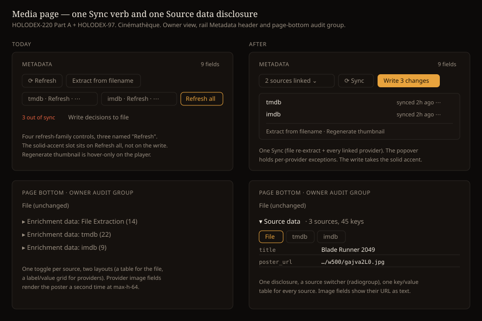

# Design Handoff: Media page — one sync verb, render-once fields (F36 / F39)

**Spec**: [Per-field source-of-truth (F36)](../specs/field-source-of-truth.md) ·
**ADRs**: [ADR-051](../architecture/archive/ADR-051-per-field-source-of-truth-decisions.md) ·
[ADR-047](../architecture/archive/ADR-047-per-item-metadata-refresh.md) ·
[ADR-056](../architecture/archive/ADR-056-provider-field-render-hints.md)
**Theming contract**: [ADR-021](../architecture/archive/ADR-021-frontend-theming-and-skins.md) +
[theming.md](theming.md) — **tokens only, QA Cinémathèque.**
**Issue**: HOLODEX-220, with HOLODEX-97 folded in as Part C · **Surface**:
`web/src/routes/media/[id]/+page.svelte`, `EnrichProviderChips.svelte`, `SourceBadge.svelte`.



---

## Overview

The owner view of `/media/<id>` is crowded, and the two causes are independent.

1. **The metadata header carries four controls whose labels are variants of "refresh"**, one of
   which is a strict subset of another. Three of them announce as the bare word "Refresh" in one
   toolbar.
2. **The page renders the same values two or three times each** — and every replace field keeps
   its full chip radiogroup permanently open, so an item with nine enriched fields shows roughly
   thirty always-live controls.

Neither is a defect in any single component; each was correct in the slice that introduced it
(F31/ADR-047, F36, F47, HOLODEX-136). This handoff records the reconciliation.

Both parts are **subtractive** — same capabilities, fewer controls. No new endpoint, no new
capability, no data-model change.

### Where the page stands (2026-10-21)

Later media-page work landed some of this design. Build only what is still open.

| Item | State |
|---|---|
| Part A, all of it | Built. |
| Part B, rows collapsed at rest | Done. `SourceBadge` shows the value and a `ProvenanceBadge` toggle; the chip row renders only when expanded. It replaced `SourceSelect` on this page. |
| Part B, poster out of the field list | Done. Title, overview, poster and genres each render once. |
| Part B, `file differs` wording | Built. The header pill is gone; its count rides the write button. |
| Part B, matching fields as one summary line | Built, owner view only. A row folds when nothing is left to decide: no standing decision, the file's value wins, and every provider offering a value agrees with it. |
| Part B, cast grid from resolved `actors` | Holds without a change. Since HOLODEX-114, `video_people` is re-derived from the resolved person fields on every scan, refresh, enrich and decision, so the grid already shows them. |
| Part C, one Source data disclosure | Built (HOLODEX-97). |

HOLODEX-113 ("show hints while metadata is updating") was closed as Won't Do, so it adds nothing
to Part A's Syncing state.

### Design-system fit (the `/design-system` check)

**No new tokens. One new component in Part B.**

- **Provider popover** (Part A) — the `⋯` menu already inside `EnrichProviderChips` promoted to
  the row level; same `role="menu"`, same `dismissable` action, same `.btn-quiet` trigger.
- **Primary write action** (Part A) — solid `bg-accent` / `text-accent-ink`, which `app.css`
  reserves for "a page's one primary action". This makes the media page use its allotment on the
  action that touches disk, rather than on `Refresh all`.
- **Expandable field row** (Part B) — a disclosure over the existing `SourceSelect`, matching the
  disclosure idiom just landed in `WritebackFormDialog` (`aria-expanded` + `aria-controls`, group
  always in the DOM, toggled with `hidden`). Reuse that, do not re-invent it.
- **New**: nothing in Part A. Part B needs one `FieldRow` wrapper owning the collapsed
  presentation + disclosure; `SourceSelect` itself is unchanged and becomes its expanded content.

---

## Part A — One sync verb

### The redundancy

| Control | Today | Does |
|---|---|---|
| `Refresh` | header, `text-muted` | `POST /media/{id}/refresh` — re-extract file **and** re-enrich every linked provider |
| `Refresh` (per chip) | one per provider | re-apply that provider's stored match |
| `Refresh all` | `.btn-accent` | re-enrich every linked provider |
| `Regenerate thumbnail` | hover-only on player | re-derive the cover |

`Refresh all` is a **strict subset** of page `Refresh`. Confirmed against `internal/refresh` —
`TestRefreshReEnrichesLinkedProviders` asserts the file commits first, then every linked provider
re-enriches from its persisted match with no picker. With one configured provider, the chip's
`Refresh` and `Refresh all` are adjacent and identical.

The a11y finding is the same finding: three controls with the accessible name "Refresh" in one
toolbar, no distinguishing context (WCAG 2.4.6 / 4.1.2).

### Layout

```
┌ METADATA ──────────────────────────────────────────────────────────┐
│                    [T][I] 2 sources linked ⌄   ⟳ Sync   [ Write 3 │
│                                                          changes ] │
└────────────────────────────────────────────────────────────────────┘

  the "2 sources linked" popover:
  ┌──────────────────────────────────┐
  │ [T] tmdb    synced 2h ago     ⋯  │
  │ [I] imdb    not matched   Match… │
  └──────────────────────────────────┘
```

| Option | What | Verdict |
|---|---|---|
| **A — status + one Sync (chosen)** | Provider chips collapse to a status summary with a popover; one `Sync`; write is the primary | Removes a control outright. Per-provider actions become exceptions, which is what they are — the resting question is "am I matched?", not "which provider do I want to re-pull?" |
| B — keep chips, drop `Refresh all` only | Minimal change | Fixes the strict-subset duplication but leaves two controls named "Refresh" and the inverted hierarchy. |
| C — chips keep per-provider Refresh, drop page `Refresh` | Inverse of B | Loses the file re-extract, which is the half providers can't do. Rejected on capability, not aesthetics. |

### States

- **No providers configured** — no status summary, no popover; the owner sees the muted "No metadata
  provider configured" hint instead ([metadata-enrichment-handoff.md](metadata-enrichment-handoff.md#edge-cases)). `Sync` remains (file re-extract is
  still meaningful) and keeps its label.
- **All providers matched** — summary reads `{n} sources linked`; popover rows show last-sync
  relative time and a `⋯` (Re-match / Refresh / Clear).
- **Some unmatched** — summary carries a `text-warn` count (`1 unmatched`); that row's action is
  `Match…` and opens `EnrichPicker`, as the chip's primary click does today.
- **Syncing** — `Sync` shows `Syncing…` and disables. Per-provider rows in the popover disable
  with it; the popover stays open and usable for reading.
- **Nothing to write** — the write button renders in its non-primary treatment with the count
  omitted, rather than disappearing. A control that vanishes when idle is harder to find than one
  that is visibly inert.

### Behaviour notes

- **`Refresh all` is deleted**, not hidden. `runEnrichRefreshAll` and `enrichRefreshAll` stay —
  they are shared with the person and studio detail pages, which are out of scope here. Only the
  media page's call site goes. Flag if those pages want the same treatment; that is a separate
  ticket.
- **The write button's count changes meaning** with HOLODEX-219 pending: it counts fields that
  will change on disk. Keep it derived from `needsWriteback()` so it cannot drift from the dialog,
  as `docs/design/writeback-selection-handoff.md` established.
- **`Regenerate thumbnail`** moves off hover. It is currently `opacity-0 group-hover:opacity-100`,
  so it does not exist on touch. Fold it into the popover or a cover control next to the player;
  either is acceptable, hover-only is not.
- **Live regions must render unconditionally.** `refreshStatus`'s `aria-live` is currently inside
  its `{#if}`, so the region is created at the same instant its content arrives — most screen
  readers do not announce that. `enrichError` has no live region at all. Both regions render
  always, empty when idle.
- **Toolbar semantics** — the action row gets `role="toolbar"` with an `aria-label`, so the
  remaining controls are announced as one group.

---

## Part B — Render once, curate in place

### The duplication

| Value | Rendered at | Note |
|---|---|---|
| poster | player `poster` attr · 256px `` in the metadata `<dl>` · writeback dialog thumb | three times |
| cast | People poster grid · `Actors` field row | **two different datasets** — see below |
| tags / genres | Tags section · `Genres` field row | file-derived vs provider |
| title | `<h1>` · `Title` field row | |
| year | header meta line · `Release date` field row | |

The cast case is the one that can actively mislead. `video.people` is written at scan time by
`replaceAssociations` from file tags; the `actors` canonical is the file+provider union. They
disagree whenever a provider contributes cast the file lacks — which is the normal case after
enrichment. Only `studio` reconciles into a real entity (`ReconcileVideoStudios`) and earns its
`→` link.

### Layout

```
┌────────────────────────────────────────────────────────────┐
│ player                                    [Cover ·tmdb ⌄]  │
├────────────────────────────────────────────────────────────┤
│ Blade Runner 2049  ·tmdb                                   │
│ 4K · 3840×2160 · 2h 43m · 2017 · 163 min · Alcon           │
├ CAST & CREW  ·file + tmdb ─────────────────────────────────┤
│ [][][][]  +7 · dir. Villeneuve                             │
├ TAGS & GENRES ─────────────────────────────────────────────┤
│ (sci-fi) (noir) (4k-remux) (Sci-Fi ·tmdb) (Drama ·tmdb)    │
├ METADATA — 9 fields, 3 differ from the file ───────────────┤
│ Overview:   Thirty years after…              ·tmdb         │
│ Release:    2017-10-04  ·tmdb  [file differs]           ⌄  │
│ Studio:     Alcon       ·tmdb  [file differs]           ⌃  │
│   ┌──────────────────────────────────────────────────┐     │
│   │ (WB ·file)  (● Alcon ·tmdb)  (+ Custom)          │     │
│   └──────────────────────────────────────────────────┘     │
│ Title · Runtime · Language · Status — all match the file   │
└────────────────────────────────────────────────────────────┘
```

| Option | What | Verdict |
|---|---|---|
| **A — chips as expanded state (chosen)** | Row shows resolved value + provenance; disclosure reveals `SourceSelect` | Nine rows instead of ~30 controls. Rows that disagree with the file carry the marker, so the page's emphasis matches where attention is needed. |
| B — section-level "Edit sources" mode | One toggle flips every row between read and curate | Fewer disclosures, but it is a mode — and the common task is fixing *one* wrong field, not auditing all nine. |
| C — leave chips open, only de-duplicate | Smallest change | Fixes the duplication but not the density, which is the reported complaint. |

### States

- **Collapsed (default)** — value, provenance tag, and (if it differs from the file) one
  `file differs` pill. The pill replaces the current `file out of sync` wording, which describes
  Holodex's bookkeeping rather than what the owner sees.
- **Expanded** — the existing `SourceSelect` renders unchanged, including its radiogroup roving
  tabindex and Custom chip. Expansion is per row and does not close other rows.
- **Visitor / non-owner** — no disclosures at all; every row renders in its collapsed form. This
  is the state the read-only page already wants and currently approximates.
- **Fields that match the file** — collapsed into one summary line naming them, expandable. They
  are the majority and carry no pending decision.
- **Merge fields** (`actors`, `genres`, `director`) keep `CurationFieldRow` and are **not**
  collapsed — they have no single resolved value to show, and per-value curation is the point.

### Behaviour notes

- **The cast section is fed by resolved `actors`**, not `video.people`, so the grid and the field
  agree by construction. This has a dependency: person entities are only created for file-derived
  people today. **Do not implement Part B's cast merge before HOLODEX-114 (F40 / ADR-059)**, which
  makes `RelinkVideoEntity` the sole writer of `video_people` derived from resolved values. Until
  then, the poster grid can only show file people, and the honest interim is to label it as such.
  HOLODEX-114 has since shipped, so the merge is unblocked.
- **`poster_url` leaves the metadata `<dl>`.** A 256px image inside a two-column definition list
  is the single largest contributor to page length. It becomes the cover control next to the
  player, where the thumbnail already is.
- **Provenance uses one primitive.** There are currently four renderings — `ProvenanceBadge`,
  `CurationChip`'s `·tag` suffix, `UrlValueList`'s inline icon, and the dialog's `·name` text.
  Part B should not add a fifth; pick one and migrate, or explicitly defer as its own ticket.
- **`text-[0.65rem]` (10.4px) must not spread.** It appears in `SourceSelect` and
  `CurationChip` today, alongside `text-[10px]` elsewhere — two invented spellings of "smaller
  than `text-xs`". Settle one micro step before adding rows that would use it.

---

## Part C — One Source data disclosure (HOLODEX-97)

### The duplication

The owner audit group at the page bottom opens one disclosure per source: `Enrichment data: File
Extraction (n)`, then `Enrichment data: {provider} (n)` for each provider. They use two layouts, a
key/value table for the file and a label/value grid for providers. A provider's image field draws
the poster a fourth time, at `max-h-64`. The payloads stay as an audit view; only the disclosures
and the duplicated rendering go.

### Layout

```
File  (unchanged)
▾ Source data · 3 sources, 45 keys
  (● File) ( tmdb ) ( imdb )
  title        Blade Runner 2049
  poster_url   …/w500/gajva2L0.jpg
```

- **One disclosure** in place of the per-source toggles, in the same spot: after `File`, inside the
  audit group (see `web/src/routes/CLAUDE.md`). The trigger keeps today's treatment, `text-sm
  text-muted hover:text-ink`, and reads `Source data · {n} sources, {k} keys`.
- **A source switcher** under the trigger: one chip per source, File first and then providers in
  their existing order. The selected chip uses the `.btn-accent` outline; the others use `.btn-quiet`
  with a `border-rule` outline, as in the mockup.
- **One table for every source.** Column one is the raw key in `font-mono text-xs text-muted`: the
  file's `source_key`, or the provider field's canonical. Column two is the value in `text-xs
  text-ink`. Rows are separated by `border-b border-rule`, as the file table is today.
- **Values.** Several values join with `, `. `long_text` cuts at 120 characters, with `…` only when
  something was cut. `image_url` shows its URL as `font-mono` text, `break-all`, with the full URL
  in `title`. No image renders in this group.

### States

- **Closed (default)**: the trigger alone. Opening it selects File, or the first provider when the
  file payload is empty.
- **One source**: no switcher. The trigger still names the count (`1 source`).
- **No sources**: the disclosure does not render, as each toggle self-omits today.
- **Visitor**: never rendered. The audit group stays wholly owner-gated.

### Accessibility

- The trigger is a `button` with `aria-expanded` and `aria-controls`, and the panel stays in the DOM
  toggled with `hidden`, the disclosure idiom Part B reuses.
- The switcher is `role="radiogroup"` with `aria-label="Source"`. Chips are `role="radio"` with
  `aria-checked`, and arrow keys move with a roving tabindex. That matches `SourceBadge`'s chip row.
- The table carries a visually hidden caption naming the selected source.

---

## Contrast

Part A and Part B reuse token pairs already measured for the writeback dialog against `--surface`
(see `writeback-selection-handoff.md`):

| | Cinémathèque |
|---|---|
| `text-muted` label | 6.00 |
| `.btn-accent` | 8.71 |

Pairs new to this surface, measured from the Cinémathèque tokens at build:

| Pair | Ratio |
|---|---|
| `text-accent-ink` on solid `bg-accent` (the write button) | 8.59 |
| `text-warn` on `--surface` (`file differs`, `· N unmatched`, `not matched`) | 5.35 |
| `text-muted` on `--surface` (popover status, Source data keys) | 6.00 |

The popover's `bg-surface` sits on the page with a `border-rule` edge; it has no `bg-surface-2`
rows, so that pair doesn't arise.

No element in either part may use `opacity` on a `text-muted` label — the theming rules treat that
as a contrast bug, and the writeback dialog just removed its last instance.

---

## Not in scope

- **Provider-supplied tag/genre density** — whether provider values join the tag vocabulary
  immediately or wait in a triage lane. Explored during the critique and deliberately unsettled:
  it interacts with HOLODEX-218 (claimed keys) and with entity identity's near-duplicate
  detection. Split it out if it survives review.
- **Person and studio detail pages** — they share `EnrichProviderChips` and `SourceSelect` and
  would likely want the same treatment. Deliberately excluded so Part A stays a single-page change
  with a shared component left backward-compatible.
- **The modal shell** — HOLODEX-215.
- **Write-target visibility in the dialog** — HOLODEX-216.
