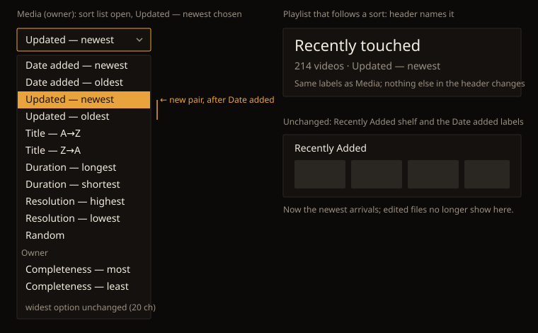

# Handoff Spec: the Updated sort pair (HOLODEX-567)

**Spec:** [phase-2 F12.1, F12.3, F12.7, F12.8](../specs/phase-2-mcp-polish.md#f12-browse-ui-polish) ·
**Toolbar:** [list-toolbar-handoff.md](list-toolbar-handoff.md) (the sort control itself)
**Date:** 2026-10-12 · **Status:** Draft, awaiting owner sign-off at `/implement`

Decided with the owner:
- **A pair, "Updated — newest" and "Updated — oldest",** rather than a single "Updated — newest"
  or a "Recently updated" phrase. It matches every other field in the list, and "oldest" is a
  real view: the files left unchanged longest.

## Overview

The Media sort list gains two options. Nothing else on the page moves: the control, its width and
its states are the toolbar handoff's. Date added keeps its labels; what they order by changes in
the spec, not here. The Recently Added shelf looks the same; it just stops showing edited files.

## Components

| Component | New or reuse | Change | Notes |
|---|---|---|---|
| Media sort list (`MEDIA_SORTS`) | **change** | Insert **Updated — newest** and **Updated — oldest** directly after Date added — oldest. Both are public, not owner-only. | Keeps "Field — direction" and the 20-character cap: 16 characters each. The widest option is still "Resolution — highest" (20), so the select doesn't grow. |
| `SortDropdown` | reuse | none | It renders the list. |
| Playlist header | reuse | none | It already names the sort from the same list, so a playlist following Updated reads "214 videos · Updated — newest". |
| `RecentlyAddedShelf` | reuse | none | Same look. Its contents follow Date added order (spec F12.3). |

URL and saved-preference values follow the existing `field_direction` keys: `updated_desc` and
`updated_asc`. Like every non-default sort, they appear in the URL; Date added — newest stays the
default and stays out of the URL.

## States and interactions

| Element | State | Behavior |
|---|---|---|
| Sort select | choose Updated — newest / oldest | Same as any sort: writes the preference, commits the URL, re-queries. |
| Sort select | visitor | Both Updated options are offered; they aren't in the Owner group. |
| Playlist sort select | following a sort | Both Updated options are offered, as with every Media sort. |

## Edge cases

- **A library where nothing has changed since import:** Updated — newest lists files in arrival
  order, the same as Date added — newest. That's correct (spec F12.1) and needs no empty state or
  hint.
- **Ties:** many files share one change time after a bulk import. The order inside a tie is stable
  across reloads (spec F12.1), so paging never repeats or skips a card.

## Accessibility notes

- No new controls. The native `<select>` announces the new options by their labels. "Updated —
  newest" reads clearly without the visual dash.

## Cinémathèque QA checklist

1. `[agent]` On Media at 375px, choose Updated — newest: the toolbar is still one row with no
   horizontal page scroll (`scrollWidth <= clientWidth`).
2. `[agent]` The options read, in order: Date added — newest, Date added — oldest, Updated —
   newest, Updated — oldest, Title — A→Z, and so on.
3. `[agent]` As a visitor, both Updated options are present and outside the Owner group.
4. `[smoke]` Write metadata back to one file: it tops Updated — newest and keeps its place under
   Date added — newest.
5. `[human]` Glance at a playlist following Updated — newest: the header names it.
