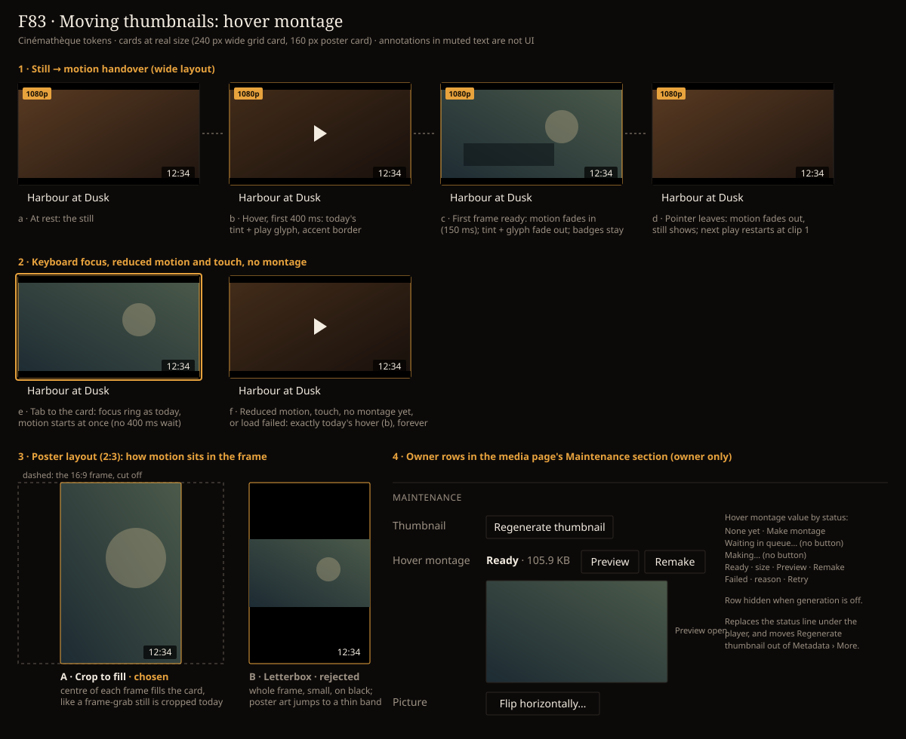

# Handoff Spec: Moving thumbnails — hover montage on grid cards (F83)

**Story:** HOLODEX-578
**Spec:** [`docs/specs/moving-thumbnails.md`](../specs/moving-thumbnails.md) · mechanism:
[`media-ingest.md`, "Hover montages"](../architecture/media-ingest.md#hover-montages-a-silent-mp4-tier-beside-the-still-pipeline-owner-gated-by-mode)
**Date:** 2026-10-25 · **Status:** Draft, awaiting owner sign-off at `/implement`

Decided with the owner on 2026-10-25, from side-by-side mockups:
- **Poster layout crops to fill.** In the 2:3 card the montage fills the frame, centre-cropped,
  the same way a frame-grab still is cropped there today. Letterboxing was rejected because the
  card would jump from a full poster to a thin band on black.
- **Generation controls live in the media page's Maintenance section** (revised with the owner
  on 2026-10-25). The section gets labelled rows: **Thumbnail** (the still's Regenerate thumbnail,
  moved out of Metadata › More), **Hover montage** (status and actions), then **Picture** (Flip
  horizontally). The first approved placement, a status line under the player, was replaced
  because image generation is file upkeep and belongs with the other repairs. A row in the More
  popover was rejected earlier because its status would only show with the popover open.
- **Escape claims the key.** When it stops a playing card it calls `preventDefault`, so the
  browse page's window-level Escape doesn't also clear the filters. On a card that isn't playing,
  Escape still reaches the page.

## Mockup

This uses the real Cinémathèque tokens from `app.css`, at real size: a 240px grid card and a 160px
poster card. Text was measured in a browser and nothing overlaps.

## Overview

`VideoCard` gains a silent `<video>` layer that plays the video's montage while the card is
hovered or keyboard-focused, then hands back to the still. This happens everywhere `VideoCard`
renders: the library grid, Home's shelves, related videos and a film's scenes. The media page's
owner-only Maintenance section gains a Hover montage row, where the owner asks for a montage and
watches it get made, and takes in the still's Regenerate thumbnail as its own row. Nothing else
changes: the list-view `VideoThumb`, the player, the poster controls and the still's load and
retry logic are untouched.

## Design tokens used

| Token / class | Usage |
|---|---|
| `--accent` (`border-accent`) | Card border while hovered, focused or playing (unchanged from today's hover) |
| `--rule` (`border-rule`) | Card border at rest; the Maintenance row buttons' outline |
| `--ink` (`text-ink`) | Status value text; button label |
| `--muted` (`text-muted`) | The row labels (Thumbnail, Hover montage, Picture); the size and failure reason |
| `--surface-2` | Frame background behind the still and the montage (`.video-frame`, unchanged) |
| `rounded-theme` (`--radius`) | Maintenance row buttons |
| `btn-ghost` | Maintenance row buttons, the same class Flip horizontally already uses |
| `bg-black/25` | Today's hover tint. It fades out while the montage plays |

There are no new tokens, and no hex value appears in a component.

## Components

| Component | Change | Notes |
|---|---|---|
| `VideoCard.svelte` | Adds a `<video>` layer inside `.video-frame`, mounted only when the video has a montage URL | The layer sits where the `` sits (`absolute inset-0 h-full w-full object-cover`), under the letterbox bars (`z-index: 1`) and the badges (`z-[2]`) |
| `montagePlayback.svelte.ts` (new, shared) | A single playback controller for the page | It holds the one active card (spec P0-4). Starting a card stops the previous one |
| `MontageStatus.svelte` (new) | The owner-only Hover montage row | Mounted in the media page's Maintenance section between the Thumbnail and Picture rows. It renders its whole row, label included, so it can hide that row in off mode |
| `media/[id]/+page.svelte` | Maintenance becomes labelled rows | `Regenerate thumbnail` leaves the Metadata › More footer for the Thumbnail row |
| `VideoThumb.svelte`, the player, poster controls | No change | |

### The `<video>` layer

- Attributes: `muted playsinline loop preload="none" disablepictureinpicture aria-hidden="true"
  tabindex="-1"`, no `controls`, no `poster` (the still underneath is the poster).
- `muted` is needed because a hover is not a user activation, and only muted video may start
  without one. Leave `devSilence.ts` exactly as it is. It also pins this element to volume 0 in
  dev, which is harmless because the montage has no audio track.
- The layer starts at `opacity-0`. It moves to `opacity-100` on the element's first `playing`
  event, never on `src` assignment. That is what keeps the still on screen until real motion
  exists (spec P0-6).
- `object-cover` in both layouts. In poster layout this centre-crops the 16:9 frame to 2:3, the
  chosen crop.

## States and interactions

| State | Trigger | What the card shows |
|---|---|---|
| **a · Rest** | — | The still, exactly as today |
| **b · Armed** | Pointer enters (fine pointer only) | Today's hover: accent border, `bg-black/25` tint, play glyph. The montage `src` is set and loading starts. Nothing moves yet |
| **c · Playing** | 400 ms after b with the pointer still on the card, **and** the first `playing` event | The montage fades in over the still. The tint and play glyph fade out. Duration, resolution, completeness, part and scene badges stay |
| **d · Released** | Pointer leaves, or focus leaves | The montage fades out and pauses, `currentTime` is reset to 0, and the still shows. If this happens before c, the pending load is cancelled (`src` removed, then `load()`) |
| **e · Focused** | Keyboard focus lands on the card link (`:focus-visible`) | The focus ring as today. It goes straight to Playing with no 400 ms wait |
| **f · Never plays** | `prefers-reduced-motion: reduce`, no fine pointer (`(hover: hover) and (pointer: fine)` false), no montage, or the montage failed to load | Exactly today's hover (b), with no `<video>` request at all, or none after the failure |

- **Escape** while a focused card is playing stops it (state d) without moving focus.
- **One at a time:** entering card B while A plays releases A first.
- **Scrolling** a playing card off screen releases it: an `IntersectionObserver` sees it go below
  0 visibility.
- **Click while playing** opens the video, as any click on the card does today. The `<video>` takes
  no pointer events (`pointer-events-none`).
- **Failure:** the `<video>` `error` event marks that card's montage as failed for this page view.
  The card falls back to f, with no retry and no console noise beyond one `console.debug`.

## Media page: the Maintenance rows

The owner-only Maintenance section (`space-y-3`) holds three labelled rows. Each row is
`flex flex-wrap items-start gap-x-3`, with a `w-28` muted `text-sm` label and then its content.
The buttons are `btn-ghost rounded-theme px-3 py-1.5 text-sm`, like Flip horizontally.

1. **Thumbnail:** `Regenerate thumbnail` (`Regenerating…` while the request runs).
2. **Hover montage:** the status value in `text-ink`, then its actions inline. The whole row is
   hidden when the generation mode is off.
3. **Picture:** the existing Flip horizontally button, its status pill, held-original card and
   retry line, unchanged.

| Status | Value text | Actions |
|---|---|---|
| None | `None yet` | `Make montage` |
| Waiting | `Waiting in queue…` | none |
| Making | `Making…` | none |
| Ready | `Ready · 248 KB` | `Preview` · `Remake` |
| Failed | `Failed · can't read file` (the reason truncates to one line, with the full text in `title`) | `Retry` |

- No disabled buttons. While it is waiting or making there's nothing to press, so no button is
  shown.
- **Preview** toggles a 240px-wide montage under the row, playing muted on loop: the same `<video>`
  attributes as the card, with autoplay on toggle. It lets the owner judge a montage while testing
  without leaving the page. Toggling again, or leaving the page, removes it. Reduced motion shows
  the first frame paused, with a play/pause control.
- **Live status:** after Make, Remake or Retry, the row polls about every 3 seconds while it shows
  Waiting or Making. It stops polling on Ready or Failed, and when the page unmounts.
- The status value sits in `aria-live="polite"`, so a screen reader hears "Ready" or "Failed"
  without moving focus.
- **Narrow widths:** the row wraps. The actions move to their own line, aligned left. The label
  and value never truncate except the failure reason.
- Visitors never see the row.

## Activity view

The montage queue gets one more row in the existing queue list, built exactly like the still
thumbnails row. It shows `Montages`, the mode (`manual`, `automatic` or `off`), then waiting, in
progress and workers (spec P0-14). There is no new pattern, so no mockup.

## Responsive behaviour

| Breakpoint | Changes |
|---|---|
| Any width, fine pointer | Hover and focus behaviour as specified |
| Touch-only devices | f only: cards never play. The Maintenance rows still work, so the owner can make montages from a phone |
| < `sm` | A Maintenance row wraps its actions under its value |

## Edge cases

- **The montage arrives while the card is hovered:** nothing happens until the next hover. The
  list payload is not refetched.
- **Slow connection:** the card stays in b (still, tint, glyph) until the first frame plays. There's
  no spinner, because the still is the loading state.
- **Very short video with no montage** (spec P0-2): f. On the Hover montage row that is `None yet`, and
  if the owner asks anyway, `Failed · too short`.
- **The still itself is still generating** (`thumb-shimmer`): the montage layer is not armed
  until the still has loaded. That keeps both layers from shimmering at once.

## Animation / motion

| Element | Trigger | Animation | Duration | Easing |
|---|---|---|---|---|
| Montage layer | First `playing` | opacity 0 → 1 | 150 ms | ease-out |
| Tint and play glyph | Montage layer visible | opacity → 0 | 150 ms | ease-out |
| Montage layer | Release | opacity 1 → 0, then pause | 150 ms | ease-in |
| Arm delay | Pointer enters | timer only, no animation | 400 ms | — |

All of these sit under `@media (prefers-reduced-motion: no-preference)`. Under `reduce`, the
layer never mounts.

## Accessibility notes

- The `<video>` is decorative (`aria-hidden`, `tabindex="-1"`). The card link's accessible name
  doesn't change.
- Keyboard users get the same preview on focus and can stop it with Escape.
- Reduced motion is honoured on every card, and the Preview on the media page falls back to a
  paused first frame.
- The Hover montage row's buttons use plain verbs (`Make montage`, `Preview`, `Remake`, `Retry`). Its
  value is announced politely.
