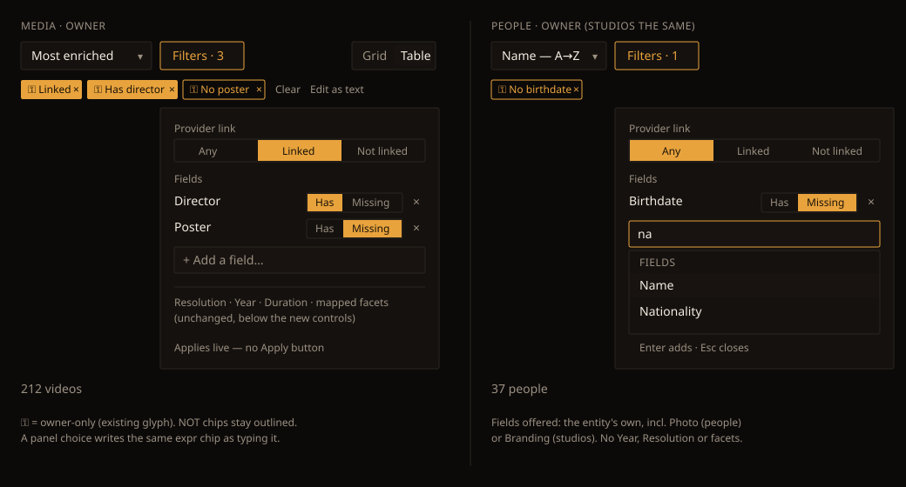
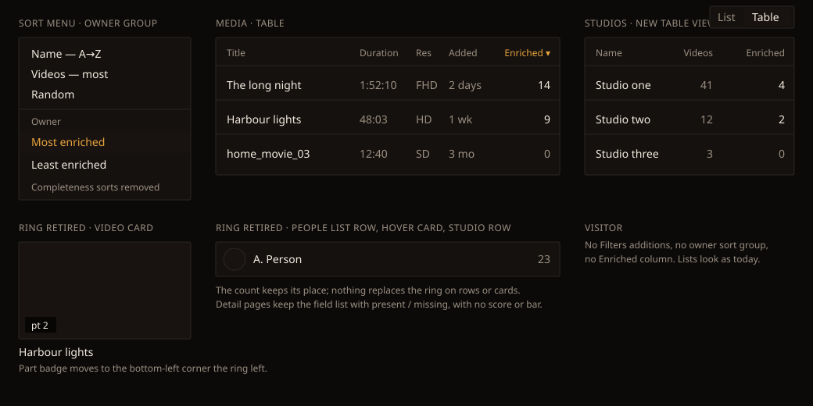

# Handoff Spec: Provider link and field filters, enriched sort, ring retired (F90)

**Spec:** [provider-and-field-filters.md](../specs/provider-and-field-filters.md) (F90) · **Extends:**
[list-toolbar-handoff.md](list-toolbar-handoff.md) (F73),
[query-language-handoff.md](query-language-handoff.md) (F87) and
[smart-playlist-rules-handoff.md](smart-playlist-rules-handoff.md) (F89) · **Jira:** HOLODEX-626
**Owner choices, 2026-11-07:**
- field conditions use **option A**: only chosen fields show, each with a Has / Missing toggle, added
  through **+ Add a field…**
- Studios gains a **Table view** so the Enriched column appears on all three lists

Cinémathèque only.

## Overview

The owner's Filters panel gains two controls on Media, People and Studios: **Provider link** and
**Fields**. People and Studios get the Filters button, panel and chips row they don't have today.
The sort menu's owner group swaps the two Completeness sorts for **Most enriched** and **Least
enriched**, and Table view's owner-only **Done** column becomes **Enriched**, a number. The
completeness ring goes from every card, row and hover card.

What each condition matches, what counts as enriched, and what visitors are refused are all in the
F90 spec. This doc covers only what the owner sees and touches.

| F90 | Covered here |
|---|---|
| P0-2 `has` on Media | Chip labels, Fields control on Media |
| P0-3 Filters control | Layout items 1–3, States and interactions |
| P0-4 Enriched sort and column | Sort menu, Table view, Studios Table view |
| P0-6 Score retired | Ring removal |
| P0-7 Queue and detail list | Detail-page field list without score |
| P0-8 Owner-only | Visitor view |

## Divergences from shipped F73, F87 and F89

1. **People and Studios get a Filters button and a chips row.** F73 gave them neither. They reuse
   `ListToolbar`'s `filters` and chips slots, as Media does.
2. **`matched:any` chips read "Linked"**, and `-matched:any` reads **"Not linked"**, matching the
   panel's words. F87's chip read "matched" and "not matched". `matched:provider-1` reads
   **"Linked: provider-1"**.
3. **On Media, panel choices write query chips.** Today panel fields write their own URL params and
   draw separate chips. The two new controls instead add or remove `matched:` and `has:` conditions
   in `?expr=`, so a chip from the panel is identical to one typed. Resolution, Year, Duration and
   the mapped facets keep their current params.
4. **Studios gains a Table view.** The page gets the `ViewToggle` (List / Table) that People has.
5. **The Done column and the ring are removed.**

## Layout

### 1. Filters button (all three lists)

The shipped `FiltersButton` unchanged: "Filters", or "Filters · n" with the accent border when
something is active. On Media, `n` now also counts the panel's Provider link and Fields choices,
even though they're query chips. On People and Studios it counts their filters.

### 2. Filters panel

The shipped `FilterPanel` (a 320px popover from `sm` up, a bottom sheet below), with the new
controls **above** the existing ones:

1. **Provider link**: caption `text-xs text-muted`, then a segmented control styled like Resolution:
   **Any** · **Linked** · **Not linked**. Any is the default and writes nothing.
2. **Fields**: caption, then one row per chosen field:
   - the field's label, `text-sm text-ink`, truncated with an ellipsis;
   - a two-segment toggle, **Has** · **Missing**, in the Resolution style at `text-xs`;
   - a `×` remove button, `btn-quiet`.
   - Under the rows, **+ Add a field…**, an input styled like the panel's number inputs.
3. On Media, a hairline `border-rule` divider, then Resolution, Year, Duration and the mapped facets
   as today. People and Studios have nothing below.

Everything applies live, as the panel does today. The bottom sheet's footer keeps **Clear all** and
the live count.

### 3. Add a field

Typing or focusing **+ Add a field…** opens a list under the input, built from
`QuerySuggestPanel`'s row style:
- one uppercase `text-xs text-muted` group header, "Fields";
- rows `px-3 py-1.5 text-sm`, highlighted row `bg-surface-2`;
- the list filters by substring as the owner types, case-insensitive.

The rows are the fields that apply to that list, in mapping order:
- Media: its mapped fields, plus Released and Poster.
- People: Name and the person fields, plus Photo.
- Studios: Name and the studio fields, plus Branding.

Fields already chosen are left out. Choosing one adds its row set to **Has**, clears the input and
keeps focus there for the next. With nothing left to add, the input reads "All fields added" and is
inert. There is no "no matches" row: an empty filter shows the header with "No field matches".

### 4. Chips row

The shipped chips row and `FilterChip`. New and changed labels:

| Condition | Chip | Style |
|---|---|---|
| `matched:any` | Linked | solid |
| `-matched:any` | Not linked | NOT (outlined) |
| `matched:provider-1` | Linked: provider-1 | solid |
| `has:director` | Has director | solid |
| `-has:director` | No director | NOT (outlined) |
| `has:poster` / `-has:poster` | Has poster / No poster | solid / NOT |
| People, Studios: Birthdate missing | No birthdate | NOT (outlined) |

The field word is the field's label, lower-cased after "Has" and "No". All of these carry the
existing owner-only key glyph. `-has:` drops the generic "not " prefix: "No director", never
"not Has director".

### 5. Sort menu

`ENTITY_SORTS` and `MEDIA_SORTS`: the owner optgroup's "Completeness — most" and "Completeness —
least" become **Most enriched** and **Least enriched** (13 and 14 characters, inside the 20-character
limit). Their place in the menu is unchanged.

### 6. Table view

- **Media and People:** the owner-only column `done` becomes `enriched`, header **Enriched**,
  right-aligned, 5rem. The cell is the count in `text-sm tabular-nums text-ink`; a 0 is `text-muted`.
  Clicking the header sorts Most enriched, then Least enriched. Media keeps `keepBelow: 'lg'`.
- **Studios, new:** Name | Videos | Enriched (owner-only), the same `ListTable` rows as People.
  The List view stays the default.

### 7. Ring removal

`CompletenessRing` is unmounted from the video card, the Media and People table cells, People list
rows, the person poster card, the person hover card and the studio list row. Nothing takes its place:
- on the video card, the part badge moves left into the corner;
- on rows, the count keeps its position.

Refreshing an entity is still on its own page. On detail pages, `CompletenessPanel` loses its headline
score and bar and keeps the field list, the not-applicable toggle and the jump to an empty field. The
owner queue's rows keep their groups and actions with no number.

## Design tokens used

Only existing tokens; no new ones.

| Token | Usage |
|---|---|
| `--surface` (`bg-surface`) | Panel, inputs, table |
| `--surface-2` | Highlighted field row, add-field input |
| `--ink` / `--muted` | Field labels / captions, Any, 0 counts |
| `--rule` | Panel border, segment borders, divider |
| `--accent` / `--accent-ink` | Selected segment, solid chips, active Filters button |
| `--radius` (`rounded-theme`) | Every control |

## Components

| Component | Change |
|---|---|
| `ListToolbar` | People and Studios fill the `filters` and chips slots |
| `FiltersButton` | Unchanged; the count includes the new controls |
| `FilterPanel` | Unchanged shell |
| `MediaFilterFields` | Gains Provider link and Fields above its controls |
| New `ProviderLinkControl` | The three-segment control; reads and writes its condition |
| New `FieldConditions` | The rows plus the add-field input and list; takes the list's field set |
| `FilterChip` / `query.ts condLabel` | New `has` labels; `matched` wording |
| `ListTable` / `listColumns.ts` | `done` → `enriched`; a Studios column set |
| Studios page | `ViewToggle`, `ListTable`, Filters |
| `CompletenessRing`, `ring.ts`, `ringRefresh.svelte.ts` | Removed once nothing mounts them |
| `CompletenessPanel` | Loses score and bar |

## States and interactions

| Element | State | Behaviour |
|---|---|---|
| Provider link | Any | Nothing written; no chip |
| Provider link | Linked / Not linked | Writes the condition; one chip appears |
| Provider link | Removing its chip | Control returns to Any |
| Field row | Has ↔ Missing | Flips the one condition in place; the chip flips solid ↔ outlined |
| Field row | × | Removes the row and its chip |
| Field chip × | — | Removes the row from the panel |
| Add a field | Focus | Opens the list; arrow keys move, Enter adds, Esc closes |
| Media panel | Query holds a condition it can't show (an OR, `matched:provider-1`, a `has` inside a NOT group) | Provider link stays Any, no field row is drawn for it, and the chip stays as typed. Opening or closing the panel never rewrites the query |
| Media panel | `has:x` typed in the query field | The panel shows a Has row for x |
| People / Studios | Filters set | State in the URL; Back and reload restore it |
| Any list | Result empty | The list's empty state, "No people match these filters.", with **Clear filters** (`btn-quiet`) |
| Count line | Filters set | Live count reflects them, as today |
| Enriched sort | Ties | No visible marker; the order is the list default |

## Responsive behaviour

| Breakpoint | Changes |
|---|---|
| `sm` and up | Panel is the 320px popover; chips wrap |
| Below `sm` | Panel is the bottom sheet, the add-field list opens inside the sheet, not full-screen; chips scroll sideways |
| Below `lg` | Media's Enriched column hides, as Done did; People and Studios keep it |

## Edge cases

- **Long field labels:** truncated in the row and in the chip at 12rem; the full label is the row's
  `title`.
- **20+ fields:** the add-field list scrolls inside a `max-h-64` box; the panel itself never scrolls
  for it.
- **A field removed from the mapping:** its chip shows the existing `problem` (warn outline) style
  and its panel row is dropped.
- **A video card with no thumbnail at all:** unchanged by F90.
- **Visitor:** none of these controls, chips, sorts or columns render. A visitor's list is exactly
  today's minus the ring.

## Animation / motion

None new. The panel and list keep their current open and close behaviour.

## Accessibility notes

- Provider link and each Has / Missing toggle are `role="radiogroup"` with an `aria-label`
  ("Provider link", "Director: has or missing"); arrow keys move between segments.
- The × on a field row is a button labelled "Remove director".
- The add-field input is a combobox whose list only suggests, so focus stays in the input and ↑/↓
  move `aria-activedescendant`, the approved exception used by the media page's tag input
  ([media-tag-input-handoff.md](media-tag-input-handoff.md)). Enter adds.
- Adding or removing a field announces the new count through the existing aria-live count line.
- The Enriched column header announces its sort direction as other sortable headers do.

## Cinémathèque QA checklist

1. [agent] Media: choose Linked, then Not linked, then Any; the chip appears, flips to "Not linked"
   outlined, then disappears.
2. [agent] Media: add Director (Has) and Poster (Missing); the chips read "Has director" and "No
   poster" with the key glyph, and match typing `has:director -has:poster`.
3. [agent] Media: type `has:director OR has:actors`; open and close the panel; the query is
   unchanged and no row is drawn.
4. [agent] People: Birthdate Missing; the URL carries it; reload and Back restore it.
5. [agent] Studios: the Table view shows Name, Videos and Enriched; the header sorts both ways.
6. [agent] No ring on any card, row or hover card, for owner or visitor.
7. [agent] Below `sm`: the bottom sheet holds both controls and the add-field list.
8. [human] With the real mapping's field count, the add-field list is quick to use.
9. [agent] Visitor: no Provider link, Fields, enriched sorts or Enriched column anywhere.
