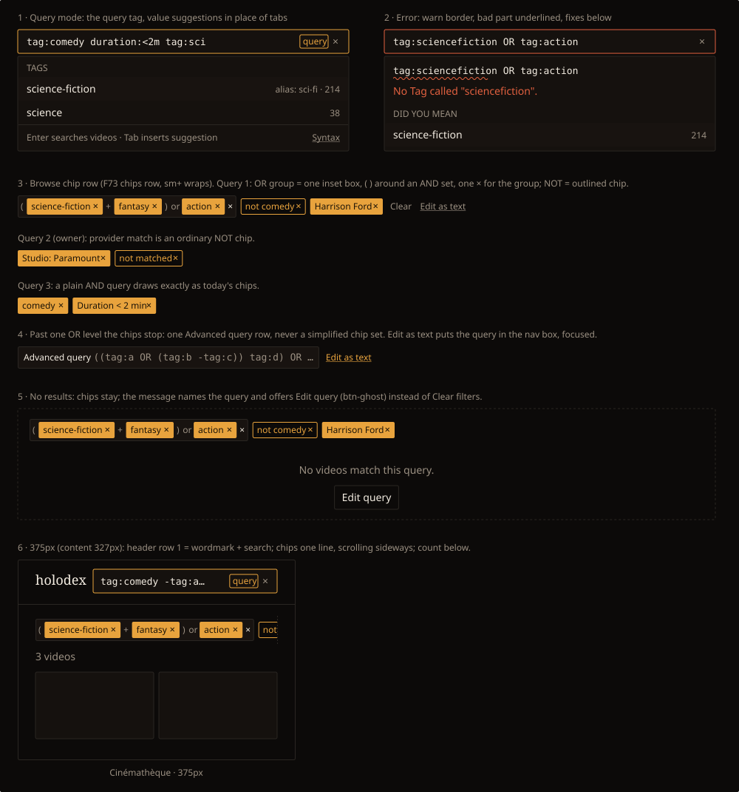

# Handoff Spec: Query language — nav search query mode and browse query chips (F87)

**Spec**: [query-language.md](../specs/query-language.md) (behaviour, limits, visitor rules).
**Architecture**: [browse-and-list-state.md, "Boolean queries"](../architecture/browse-and-list-state.md#boolean-queries-an-expr-key-parsed-once-in-go-compiled-through-the-builders-fragments)
(the parse endpoint the chips and errors render from).
**Builds on**: [nav-search-live-filter-handoff.md](nav-search-live-filter-handoff.md) (the panel),
[list-toolbar-handoff.md](list-toolbar-handoff.md) (the chips row), [media-tag-input-handoff.md](media-tag-input-handoff.md)
(the text-input autocomplete pattern), [theming.md](theming.md).
**Story**: [HOLODEX-611](https://whoiskevinrich.atlassian.net/browse/HOLODEX-611).

## Decided with owner (2026-10-31)

- **OR groups are one inset box**, members joined by `or`, an AND set inside the group wrapped in
  `( … )` with `+` between its chips, and one `×` that removes the whole group. *(Option A, with the
  owner's change: keep the parentheses so AND sets read clearly.)*
- **NOT is an outlined accent chip** whose label starts with `not`. Warn stays reserved for errors.
- **Query mode, error panel and the Advanced query row** approved as drawn.
- Chips draw **one OR level** (whose members may be AND sets). Anything deeper is the Advanced query
  row; the chips never draw a simplified or wrong version of a query.

## Mockup

Drawn with Cinémathèque tokens at component sizes, Archivo text widths measured in the browser.

## Overview

A visitor or the owner types a query into the nav search box (panel 1). Once the text holds a field
condition, operator or parenthesis, the box is in **query mode**: a `query` tag shows in the field and
the panel suggests fields and values instead of showing the All / People / Videos tabs. Enter opens
browse with the query applied. Browse shows the query in F73's chips row (panels 3 to 5), and the same
row on a phone scrolls sideways (panel 6). A query that can't run explains itself in the panel and
does not run (panel 2).

## Layout

- **Nav search box**: unchanged position and size (`max-w-md`, `flex-1`; about 34px tall). Query
  text renders in `font-mono` at 13px while in query mode, so offsets and the error underline line up.
- **`query` tag**: inside the field, left of the clear `×`: `rounded-theme border border-accent px-1
  text-xs text-accent`, 18px tall, vertically centred. The input's right padding grows by the tag's
  width so text never runs under it.
- **Suggestion panel**: the existing dropdown panel (same surface, border, radius, shadow, 70vh max,
  full-width sheet below 640px). Contents top to bottom: group header (`text-xs font-medium uppercase
  tracking-wide text-muted`, as today), suggestion rows (`px-3 py-1.5 text-sm`, sub on the right in
  `text-xs text-muted`), then a footer row (`border-t border-rule px-3 py-1.5 text-xs text-muted`)
  with the key hint on the left and a `Syntax` link on the right.
- **Browse chips row**: F73's `data-list-chips` row, unchanged: wraps from `sm` up, one line with
  sideways scroll below `sm`. Query chips come after scope chips and before toolbar-facet chips. After
  the chips: `Clear` (F73, at 2+ chips) then `Edit as text` (`btn-quiet text-xs`, underlined).

## Design tokens used

| Token | Value | Usage |
|---|---|---|
| `--accent` / `text-accent`, `border-accent` | `#e8a33d` | Chip fill; NOT chip outline and text; `query` tag; focused field border |
| `--accent-ink` | `#1a1206` | Text and `×` on a filled chip |
| `--surface` | `#15110e` | Field, panel |
| `--surface-2` | `#181310` | OR group inset; active suggestion row |
| `--rule` | `#2a2622` | Field, panel and OR group borders; dividers |
| `--ink` / `--muted` | `#f3ece1` / `#9b9082` | Text / connectives (`or`, `+`, `( )`), subs, hints |
| `--warn` | `#e2603f` | Error field border, underline, error sentence |
| `--radius` (`rounded-theme`) | 2px | Every box here |
| `font-ui` 12 / 14px, `font-mono` 13px | | Chips and captions / rows / query text |

## Components

| Component | Variant | Props | Notes |
|---|---|---|---|
| `FilterChip` | `filter` (existing) | `label`, `onremove` | Plain query conditions, unchanged |
| `FilterChip` | **`negated`** (new) | `label` (starts with `not `), `onremove` | Transparent fill, 1px `border-accent`, `text-accent`; same 22px height and `×` |
| `QueryChipGroup` (new) | — | `members: (Condition \| Condition[])[]`, `onremove`, `onremovemember` | Inset box `border border-rule bg-surface-2 rounded-theme p-1 gap-1`, 30px tall; members are `FilterChip`s; an AND set is wrapped in muted `(` `)` with muted `+` between; `or` between members; trailing group `×` in `text-ink` |
| `AdvancedQueryRow` (new) | — | `text`, `onedit` | Same inset box as the group: `Advanced query` in `text-ink text-xs`, then the canonical query in `font-mono text-[13px] text-muted`, truncated with an ellipsis; `Edit as text` link (`text-accent text-xs underline`) after the box |
| Nav search input | query mode | — | Adds the `query` tag and mono text; `role="combobox"`, `aria-activedescendant` (the `TagAddInput` rule: focus stays in the input) |
| Suggestion row | — | `label`, `sub` | Same row as the panel's result rows; a Tag row's sub shows a matched alias and the video count |

## States and interactions

| Element | State | Behaviour |
|---|---|---|
| Nav input | plain words | Today's live tabbed search, unchanged |
| Nav input | query mode | `query` tag shows; tabs hidden; suggestions for the field under the caret (field names before a `:`, values after) |
| Suggestion | highlighted | `bg-surface-2`; ↑/↓ move the highlight, focus stays in the input |
| Suggestion | Tab or click | Inserts the value at the caret (quoted if it has a space), adds a trailing space, keeps focus |
| Nav input | Enter, valid | Records history, opens browse with the query, closes the panel |
| Nav input | Enter, invalid | Nothing runs; the error stays shown |
| Nav input | error | Border `border-warn`; panel top shows the mono echo with the bad part wavy-underlined in warn, then one sentence in `text-sm text-warn`, then `Did you mean` rows (Tab or click replaces the bad part). Ambiguous name: the rows list each match with a distinguishing sub |
| Nav input | error echo markup | The echo is three text nodes (before, bad part, after) sliced at the parse response's offsets; never `{@html}` |
| Nav input | parse pending | Previous suggestions stay; no spinner under 300ms, then the panel's existing pulse rows |
| Chip `×` (plain or NOT) | click | Removes that condition; focus moves to the next chip, else `Edit as text` |
| Member chip `×` in a group | click | Removes that member. A group left with one member becomes a plain chip; an AND set left with one chip loses its parentheses |
| Group `×` | click | Removes the whole group |
| `Edit as text` | click | Puts the query, with current names, into the nav box in query mode, focused, caret at the end |
| Toolbar facet | changed | Adds or updates its chip (F73 behaviour) |
| `Clear` | click | Clears the query, scope and facets (F73: not the sort) |
| Browse, query matches nothing | — | Chips stay; message `No videos match this query.` (`py-16 text-center text-sm text-muted`) and an `Edit query` button (`btn-ghost px-3 py-1.5 text-sm`) that does what `Edit as text` does. F73's `Clear filters` copy stays for facet-only filters |
| Browse, query refused (shared link with an owner-only part, a stale name, too large) | — | A notice above the grid, `rounded-theme border border-warn bg-surface px-3 py-2 text-sm text-ink`, saying why in one sentence (copy below), with `Edit query`. No grid, no partial results |

**Copy** (sentence case, no "Error:" prefix):
- Unknown name: `No Tag called "sciencefiction".` (and `No person called …`, `No studio called …`)
- Ambiguous: `More than one person is called "Sam Lee". Pick one.`
- Unknown field: `"genre" isn't something you can search by.`
- Brackets: `This query has an unclosed bracket.`
- Range: `Use a range like duration:20m..1h.`
- Owner-only (visitor): `Part of this query is only available to the owner.`
- Too large: `This query is too long to run. Try splitting it.`

## Responsive behaviour

| Breakpoint | Changes |
|---|---|
| ≥ 640px | Panel drops under the box; chips row wraps; group boxes never split across lines (a group wraps as a unit) |
| < 640px (375px frame: 327px content) | Header row 1 = wordmark + search; the query text scrolls inside the field and the `query` tag stays visible. Panel is the full-width sheet. Chips row is one line and scrolls sideways; a group is one unit in the scroll |

## Edge cases

- **Long names**: chip labels truncate at `max-w-[12rem]` with a `title`, inside groups too.
- **Many members**: a group grows; on desktop it wraps as a unit to its own line. No member limit
  in the UI; the spec's limits refuse oversize queries first.
- **Bare words**: a bare word's chip reads `comedy · title or Tag`, all in the chip's own text
  colour (no opacity on text). Not drawn in the mockup; it is a plain `FilterChip` with that label.
- **Only negations**: chips show only NOT chips; the count line reads normally.
- **Names change**: chips show current names (the parse response), never the typed spelling.
- **Slow parse on browse**: the previous chips stay until the new parse returns; the grid uses its
  existing loading state.

## Animation / motion

None new. Chips appear and disappear without transitions, as F73 chips do.

## Accessibility notes

- **Focus order** on browse: toolbar controls → chips left to right (a group: its member chips, then
  the group `×`) → `Clear` → `Edit as text` → count line.
- **ARIA**:
  - Nav input in query mode: `role="combobox"`, `aria-expanded`, `aria-controls` the suggestion
    listbox, `aria-activedescendant` the highlighted row; `aria-describedby` points at the error
    sentence when there is one.
  - The `query` tag is `aria-hidden`; an `sr-only` live region says `Query mode` once on entry.
  - Group: `role="group"` with `aria-label="Any of: science-fiction and fantasy, or action"`; group
    `×`: `aria-label="Remove group: science-fiction and fantasy, or action"`.
  - NOT chip `×`: `aria-label="Remove filter: not comedy"`.
  - Advanced row: the full query text in `aria-label`; `Edit as text` is a button.
- **Not colour alone**: NOT reads `not …`; errors carry a sentence as well as the underline and border.
- **Target size**: chip `×` keeps F73's current size (HOLODEX-593 tracks the 24px fix for all chips).

## Cinémathèque QA checklist

1. `[agent]` Query mode: typing `tag:comedy duration:<2m` shows the `query` tag and Tag suggestions; tabs hidden.
2. `[agent]` Tab inserts `science-fiction` at the caret; Enter opens browse with the query.
3. `[agent]` `tag:sciencefiction` shows the warn border, underline, sentence and `science-fiction` fix; Enter does nothing.
4. `[agent]` Browse for query 1 draws the group box with `( … + … ) or …`, the outlined `not comedy`, and `Harrison Ford`, measured: chips 22px, group 30px.
5. `[agent]` Removing `fantasy` turns `( science-fiction + fantasy )` into `science-fiction`; removing a second member collapses the group into a plain chip.
6. `[agent]` A three-level query shows the Advanced query row only; `Edit as text` fills the nav box.
7. `[agent]` 375px: the chips row scrolls sideways on one line with no page overflow; the `query` tag stays visible in a long query.
8. `[human]` Read query 1's chips aloud with a screen reader; the group label states the logic.
