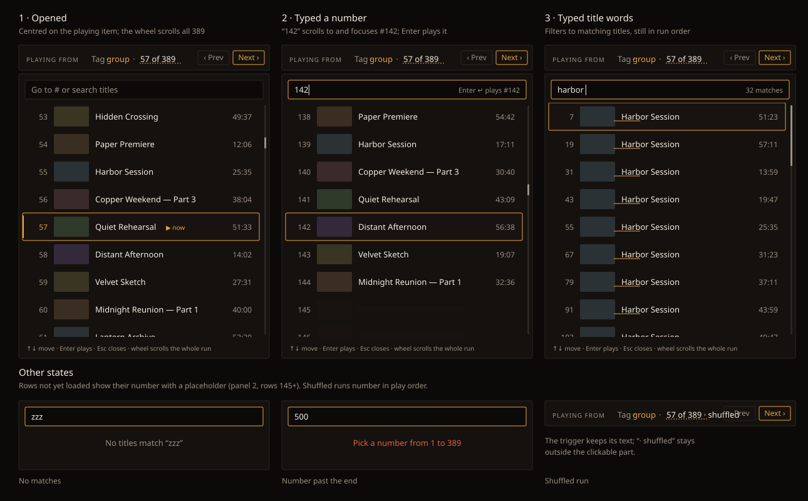

# Design handoff — jump to a position in a run (HOLODEX-564)

The run strip's `n of N` becomes a button. It opens a popover listing every item in the run, so
you can jump to any of them by number or by title. The run strip itself is described in
[smart-playlists-handoff.md](smart-playlists-handoff.md) §3 and
[video-playlists-handoff.md](video-playlists-handoff.md) §5. The behaviour rules are in the run
spec, [smart-playlists.md](../specs/smart-playlists.md).

Option A of three, approved 2026-10-11. The other two were a number field with a one-item preview
and a scrubber. A list won because it handles both "go to #142" and "find the one called…" in one
box, and it shows the items around the target, not just the target.

## What changes on screen

| Surface | Change |
|---|---|
| `NextUpStrip.svelte`, the position text | `n of N` becomes the popover's trigger. `· shuffled` and `— playback stops here` stay plain text after it. |
| New `video/RunJumpPopover.svelte` | The popover: a query input over a list of the run's items that scrolls with the mouse wheel. |

Nothing else in the strip moves. Prev, Next, Shuffle, Repeat and the next-up tile are untouched.

## Trigger

- A `<button type="button">` wrapping only the `n of N` text. It keeps the text's size and colour
  (`text-muted`), with no border and no padding change, so the strip doesn't reflow.
- Affordance: a dashed underline in `border-muted`. It turns to `border-accent` and the text to
  `text-ink` on hover and on `:focus-visible`.
- Rendered in the **Playing from** and **Last in** states. In the **Not in** state the position
  text is a sentence ("this video was removed…"), and *Play from start* is already the way back,
  so there's no trigger.
- `aria-haspopup="dialog"`, `aria-expanded`, and an accessible name of "Go to a position, 57 of 389".

## Popover

- Anchored under the trigger, aligned to its left edge, and moved left if it would overflow the
  viewport. It's a sibling of the strip's text, inside the strip, and **never a wrapper around the
  player** (see `video/CLAUDE.md`).
- Box: `bg-surface border border-rule rounded-theme`, width `min(26rem, 100vw - 2rem)`, padding
  `p-2.5`. No shadow, no animation. It opens and closes instantly, like the other popovers.
- Dismissal uses the shared `use:dismissable` on the element that holds both the trigger and the
  panel: click outside or Esc. Focus goes back to the trigger.
- Role `dialog`, `aria-label="Go to a position in this run"`.

### Query input

- Full width. Placeholder: "Go to # or search titles". Focused when the popover opens.
- Resting border `border-rule`, `border-accent` once it has text. Background `bg-bg`.
- A muted caption sits inside its right edge (`text-xs text-muted`) and reacts to what's typed:
  - digits only, in range: "Enter plays #142"
  - title words: "12 matches" or "1 match"
  - empty: nothing

### List

- **Scrolls with the mouse wheel over the whole run.** `overflow-y: auto`, and
  `overscroll-behavior: contain` so reaching the top or bottom doesn't start scrolling the page
  behind it. The pointer doesn't need to be on the scrollbar. A wheel anywhere over the rows
  scrolls them.
- The visible height is **8½ rows** (`max-height` = 8.5 × row height). The half row is the hint
  that there's more. A run shorter than that sizes the list to fit and doesn't scroll.
- Rows are a fixed height so a long run can be **virtualised**. Only the rows in view, plus a
  buffer, are in the DOM. A spacer keeps the scrollbar's length and position true to the whole run,
  so dragging the scrollbar or flinging the wheel lands where you'd expect in a 389-item run.
- On open, the list scrolls so the playing item sits in the middle (or as near as the ends allow).

### Row

Fixed height `h-11` (44px). It's an `<a href={runHref(id, run)}>`, so middle-click and copying the
link work like the strip's Next. Left to right:

| Part | Treatment |
|---|---|
| Position | Right-aligned `w-8`, `text-xs text-muted tabular-nums`. `text-accent` on the playing item. |
| Thumbnail | `h-8 w-14 rounded-theme bg-black object-cover`, the same as the strip's next-up tile. `loading="lazy"`. |
| Title | `truncate`, `text-sm text-ink`. `font-medium` on the playing item. |
| Now marker | Playing item only: `▶ now`, `text-xs text-accent`, after the title. It shrinks before the title does. |
| Duration | `formatDuration`, `text-xs text-muted`, right-aligned and never truncated. |

- **Playing item:** a 2px `bg-accent` bar on the left edge (an inset, not a border, so the row
  doesn't shift), plus the accent number and the now marker. Colour is never the only signal,
  because the marker is text.
- **Hover:** `bg-surface-2`.
- **Focused (keyboard):** `bg-surface-2` with a 1px `outline-accent` (`:focus-visible`).
- A shuffled run numbers rows in **play order**, the same numbers the strip shows. The original
  order isn't shown.

## Typing in the input

| What's typed | Result |
|---|---|
| Nothing | The whole run, numbered, scrolled to the playing item. |
| Digits from 1 to N | The list stays whole. It **scrolls to that row and highlights it**, without filtering, so its neighbours are still around it. Enter plays it. |
| Digits outside 1 to N | The list stays where it was. A line under the input in `text-warn`: "Pick a number from 1 to 389". Enter does nothing. |
| Anything else | Case-insensitive substring match on titles. Only matching rows stay, **in run order with their original numbers**, and the match is underlined in `accent`. Enter plays the first match. |
| Words with no match | The list is replaced by one centred `text-muted` line: "No titles match “zzz”". |

## Choosing an item

- A click or Enter plays the item. It navigates to `runHref(id, run)` and sets the play intent, the
  same as the strip's Next. The popover closes.
- Choosing the item that's already playing just closes the popover. Nothing reloads.

## Keyboard

The list uses a **roving tabindex**: one row has `tabindex=0` and the rest `-1`. It doesn't use
`aria-activedescendant`.

| Key | Where | Does |
|---|---|---|
| ↓ | Input | Focus the highlighted row: the typed number, the first match, or the playing item. |
| ↑ / ↓ | List | Previous / next row. ↑ on the first row goes back to the input. |
| Page Up / Page Down | List | Move 8 rows. |
| Home / End | List | First / last row. |
| Enter | Input or list | Play, as above. |
| Esc | Anywhere | Close, and focus goes back to the trigger. |
| A printable character | List | Focus goes to the input and the character is added to it. |
| Tab | Anywhere | Moves between the input and the list's one tabbable row. It doesn't trap focus. Tabbing out closes the popover. |

## Loading and missing data

- The run only holds ids, so a row's title, thumbnail and duration may not have arrived yet. Until
  they do, the row shows its **number** with `bg-surface-2` blocks where the thumbnail and title
  will be (panel 2 of the mockup, rows 145 and later). The row is clickable and plays the item
  either way.
- Rows load for what's in view plus the buffer, as you scroll. A fast wheel past rows that never
  finished loading leaves them as placeholders and doesn't stop the scrolling.
- A title search has to see every title. While those are still arriving, the caption reads
  "Searching…" and matches appear as they're found. Where the titles come from is the spec's
  question.
- A row whose item fails to load keeps its number and shows "Unavailable" in `text-muted` where
  the title goes. It still navigates, and the media page explains the rest.
- A video with no thumbnail gets the same `bg-black` box the strip's tile shows.

## Responsive

| Width | Changes |
|---|---|
| ≥ 640px | As above. |
| < 640px | The popover spans the strip's width (`left-0 right-0`). Same row anatomy. The duration hides below 400px so the title has room. Touch scrolling replaces the wheel and the containment rule still applies. |

## Accessibility

- Trigger: `aria-haspopup="dialog"` and `aria-expanded`. Its name includes the position.
- Input: `aria-label="Go to a position or search titles"` and `aria-describedby` on the caption and
  the range error.
- List: `<ul aria-label="Items in this run">`. Each row is an `<a>` with an accessible name of
  "142, Distant Afternoon, 23:18", and the playing row adds ", now playing".
- An `aria-live="polite"` region reads the caption changes ("12 matches", "No titles match") and the
  range error.

## Not in scope

- A keyboard shortcut to open the popover. The strip's `p` and `n` stay the only shortcuts.
- Reordering, removing or queueing items from the popover.
- The popover in the **Not in** state.
