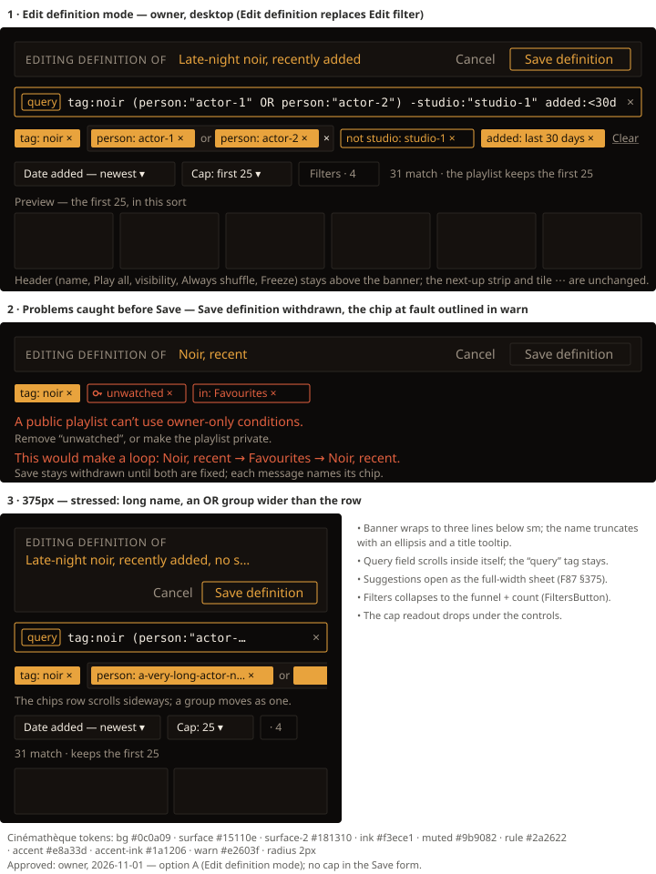
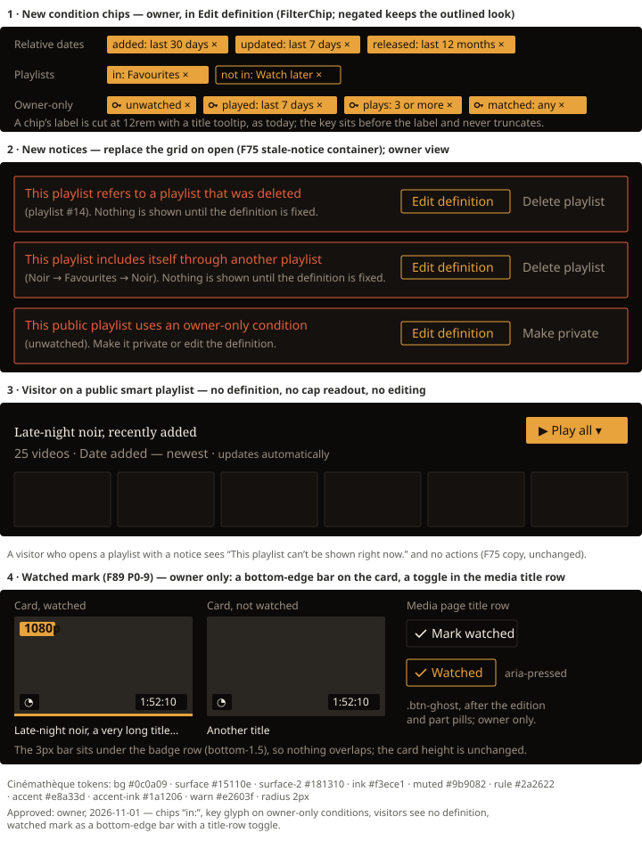

# Handoff Spec: Smart playlist rules — Edit definition on the playlist page (F89)

**Spec:** [smart-playlist-rules.md](../specs/smart-playlist-rules.md) (F89) · **Extends:**
[smart-playlists-handoff.md](smart-playlists-handoff.md) (F75) and
[query-language-handoff.md](query-language-handoff.md) (F87) · **Jira:** HOLODEX-619
**Approved:** owner, 2026-11-01:
- editing is **option A**, an *Edit definition* mode on the playlist page
- a playlist reference reads `in: ‹name›`
- owner-only conditions carry a **key glyph**
- the *Save as playlist…* form gets **no cap control**
- visitors see **no definition**

Cinémathèque only.

## Overview

A smart playlist's definition is its query, its sort and its cap. The owner edits all three without
leaving the playlist page. **Edit definition** opens a banner, a query field, the F87 chips, Sort,
Cap and Filters above the grid, and the grid becomes a live preview of what the playlist would hold.
Nothing is stored until **Save definition**. Browse's edit mode (F75 handoff §5) is retired.

The chips also learn new conditions: relative dates, playlist references (`in:` / `not in:`) and the
owner-only watch conditions. There are new notices for a deleted referenced playlist, a reference
loop, and an owner-only condition on a public playlist.

Which conditions exist, what they match, and when a definition is refused are in the F89 spec. This
doc covers only what the owner sees and touches.

## Divergences from shipped F75 / F87 (approved 2026-11-01)

1. **Edit filter becomes Edit definition** and opens a mode on the playlist page. It no longer goes
   to browse. Browse loses its edit-mode banner (`web/src/routes/+page.svelte` around 203–244 and
   367–389), and the `#edit_playlist=` fragment stops being honoured by browse. An old link carrying
   it lands on `/playlists/{id}` with Edit definition open.
2. **The header's filter summary is owner-only, and becomes read-only chips.** Today the sub-title
   appends the filter in words for everyone (`playlists/[id]/+page.svelte:281`). Under the approved
   visitor rule, a visitor sees the name, the count, the sort and `updates automatically`, and nothing
   of the definition. The owner sees the definition as read-only chips under the sub-title (no ×).
   That is the same chip model as the editor, so OR and NOT read correctly, which the words summary
   can't show.
3. **The stale-notice action is renamed** from *Edit filter* to *Edit definition*, and opens the
   mode in place.

## Layout

Order of the page, top to bottom, for the **owner**. Visitors see items 1 and 5 only.

1. **Header**: unchanged F75 §4 row (name with pencil, `smart` chip, the right-hand group), except
   *Edit filter* becomes **Edit definition** (`.btn-ghost px-3 py-2 text-sm`), hidden while the mode
   is open. The sub-title is `{count} · {sort label}`, plus ` · first {N}` when a cap is set (owner
   only, `text-xs`), plus `always shuffled` as today.
2. **Definition chips (read-only)**, owner only, mode closed. One row in the F73 chips-row classes,
   with chips rendered without ×. An `AdvancedQueryRow` takes over when the query is past one OR
   level, without its `Edit as text` link (Edit definition is the way in).
3. **Owner row**: Always shuffle and Freeze, unchanged.
4. **Edit definition panel** (mode open), replacing items 2 and 3. Panel 1 in the mockup:
   - **Banner**: `flex flex-wrap items-center justify-between gap-3 rounded-theme border border-rule bg-surface px-3 py-2`.
     - Left: `EDITING DEFINITION OF` (`text-xs uppercase tracking-wide text-muted`), then the name
       (`text-accent`, truncated with a `title`).
     - Right: **Cancel** (`.btn-quiet px-3 py-1.5 text-sm`) and **Save definition**
       (`.btn-accent px-3 py-1.5 text-sm`). It is not solid: Play all stays the page's one primary
       action.
   - **Query field**: a page-owned field with the F87 nav box's look (`font-mono` 13px, the `query`
     tag, `×` to clear, accent border while focused). It uses the same suggestion panel, error echo
     and `Did you mean` rows as the nav box.
   - **Chips row**: the F87 chips with ×, then `Clear` (2+ chips). No `Edit as text`, since the
     field is right above.
   - **Controls row** (`flex flex-wrap items-center gap-2`):
     - Sort: `SortDropdown`, compact; `Manual order` stays hidden for smart playlists.
     - **Cap**: a compact select with the same look as Sort. It reads `Cap: keep all` or
       `Cap: first {N}`; the choices are listed in the spec.
     - **Filters**: `FiltersButton` + `FilterPanel`, as on browse.
     - **The readout** (`text-xs text-muted`, `aria-live="polite"`), which is the cap readout:
       - no cap: `{M} match`
       - capped: `{M} match · the playlist keeps the first {N}`
       - when the cap is larger than the match: `{M} match`
       - when the saved count differs: append ` (was {n})`
   - **Preview label** (`text-xs text-muted`): `Preview — the first {N}, in this sort`, or
     `Preview` with no cap.
5. **Grid**: the playlist's tiles. In the mode, it shows the preview of the unsaved definition, with
   the cap applied. Outside the mode, it shows what the playlist holds now.

## Design tokens used

All from the Cinémathèque `:root` (`web/src/app.css`), as named Tailwind utilities; no literals in
components.

| Token / class | Value | Usage |
|---|---|---|
| `bg-bg` | #0c0a09 | page |
| `bg-surface` | #15110e | banner, notices, selects |
| `bg-surface-2` | #181310 | OR-group box (unchanged) |
| `text-ink` | #f3ece1 | body, group × |
| `text-muted` | #9b9082 | labels, readout, preview label, Cancel |
| `border-rule` | #2a2622 | banner, selects, Filters |
| `bg-accent` / `text-accent-ink` | #e8a33d / #1a1206 | chips |
| `text-accent` / `border-accent` | #e8a33d | name in banner, Save definition, negated chips, focused query field |
| `text-warn` / `border-warn` | #e2603f | problem chips, problem messages, notices |
| `rounded-theme` | 2px | every box |
| `font-ui` 12 / 14px, `font-mono` 13px | Archivo, ui-monospace | chips and labels; query text |
| `font-display` | Fraunces | page title (unchanged) |

## Components

Reuse first (`.claude/rules/frontend-theming.md`, "Reuse before you create").

| Component | Change | Notes |
|---|---|---|
| **Query chips (extracted)** | New shared piece in `sort/`, holding what is page-local in browse today: the `expr` parse effect, `toChips`, the scope labels, `removeQueryPart` and the chips snippet's markup | Browse and the playlist editor both render it. Browse passes its `listController` setter; the editor passes its draft setter. Browse's look is unchanged. |
| **Query field (extracted)** | New page-ownable field in `sort/`, built from the nav box's parts (`queryAssist`, `QuerySuggestPanel`, the error echo) | The nav box in `+layout.svelte` keeps working as it does; it can be moved onto the same field later, but that is out of scope. The playlist editor owns its own instance, so typing here never touches `navSearch`. |
| `FilterChip` | Two new optional props. `ownerOnly`: a 12px key glyph before the label, in the chip's own text colour, which never truncates. `problem`: a warn outline and warn text, used in the editor for the chip at fault. | `negated` keeps its outlined accent look; `problem` overrides it. A read-only variant (no × button) for the header and the visitor-free owner row. |
| `QueryChipGroup` | Passes `ownerOnly` / `problem` through to members; gains a read-only mode (no ×) | — |
| `AdvancedQueryRow` | Read-only mode (no `Edit as text`) | — |
| `SortDropdown` | Play-based sorts the spec adds go in the existing owner-only `Owner` optgroup | `compact`, `extra=[]` for smart. Visitors never see them. |
| **Cap select** | New compact `<select>` in `sort/`, styled as `SortDropdown compact` | Labels ≤ 20 characters (`SortDropdown`'s native-select rule). |
| `FiltersButton` / `FilterPanel` | none | Same as browse; edits apply to the draft. |
| F75 stale notice | New kinds (below); action renamed *Edit definition* | Same container. |
| `SavePlaylistForm` | none | No cap control (owner, 2026-11-01). Set it in Edit definition after saving. |

## States and interactions

| Element | State | Behaviour |
|---|---|---|
| Edit definition (header) | click | Opens the mode, focuses the query field, and seeds the draft from the stored query, sort and cap. The URL gains `#edit` (a fragment, so the list schema never reads it), so a reload or Back keeps the mode. |
| Query field | typing | F87 nav-box behaviour: suggestions, Tab inserts, and Enter applies the text to the draft. Chips and the preview update on apply, not per keystroke. |
| Query field | error | F87 error echo and `Did you mean` rows under the field. The draft keeps its last valid query, and Save definition is withdrawn until the text is valid or cleared. |
| Chip × / group × / Clear | click | Removes it from the draft; preview and readout update. Clearing everything is allowed ("everything, in this sort"). |
| Sort / Cap / Filters | change | Updates the draft; the preview re-reads. |
| Readout | any draft change | Announces `{M} match…` politely. |
| Save definition | default | `.btn-accent`. It saves query, sort and cap together, closes the mode and refreshes the grid, with a toast: `Saved ‹name›`. |
| Save definition | busy | Label stays, the button is withdrawn (`.btn-accent` disabled look), and the readout says `Saving…`. |
| Save definition | withheld | Withdrawn look. Below the controls, one `text-sm text-warn` sentence per problem, each followed by a `text-xs text-muted` fix, and the chip at fault turns `problem` (panel 2). Copy: below. |
| Save definition | server refusal | Same placement and look as withheld, with the server's message. The draft is kept. |
| Cancel | click | Discards the draft, closes the mode and clears `#edit`. If the draft differs from what is stored, ConfirmDialog asks `Discard changes to ‹name›?` (`Discard` / `Keep editing`). |
| Leaving the page with a changed draft | navigation | The same confirm. |
| Play all | in the mode | Plays the **saved** playlist, not the draft (the run source is the playlist). It is unchanged. |
| Visibility segment | in the mode | Stays live. Switching to Public with an owner-only chip or a private `in:` chip in the draft triggers the withheld state at once. |
| Visibility segment | Public refused | Stays on Private; see "Visibility refusal". |
| Stale notice → Edit definition | click | Opens the mode with the stored definition and the chip at fault already marked `problem`. |

### In-editor problem copy (panel 2)

| Problem | Sentence (`text-sm text-warn`) | Fix (`text-xs text-muted`) |
|---|---|---|
| Owner-only condition, playlist Public | `A public playlist can’t use owner-only conditions.` | `Remove “{chip label}”, or make the playlist private.` |
| A reference makes a loop | `This would make a loop: {this} → {A} → … → {this}.` | `Remove “in: {A}”.` |
| Reference to a shuffled, capped playlist | `“{other playlist}” is shuffled and capped, so its contents change every time.` | `Remove “in: {other playlist}”, or give it another sort or no cap.` |
| Referenced playlist deleted | `This definition refers to a playlist that was deleted.` | `Remove “in: #{id}”.` |
| Public playlist references a private one | `A public playlist can’t include a private playlist.` | `Remove “in: {other playlist}”, make “{other playlist}” public, or make this playlist private.` |
| Too deep | `Playlists can include each other at most {4} deep.` | `Remove a playlist reference.` |
| Too many playlists | `A definition can reach at most {16} playlists.` | `Remove a playlist reference.` |
| Too many conditions | `A definition can have at most {256} conditions, counting the playlists it includes.` | `Simplify the query, or remove a playlist reference.` |
| Query text invalid | F87 error copy, unchanged | F87 `Did you mean` rows |

The spec names the limit in the refusal (F89 P0-3, as F87 P0-9). The `{4}`, `{16}` and `{256}` in the
copy are not literals: each one is the limit the server returns. That way the copy stays correct if
[security-perimeter.md](../architecture/security-perimeter.md) ("Smart playlist rules") changes a
number. If several limits are crossed, show the first one in this table's order.

### Visibility refusal

Making a smart playlist **Public** can be refused: it, or a playlist it reaches through references,
includes a private playlist or an owner-only condition. The Private | Public segment stays on
Private, and a `text-sm text-warn` line appears under the header row, followed by a
`text-xs text-muted` fix. It clears on the next visibility change or on opening Edit definition.

| Cause | Sentence | Fix |
|---|---|---|
| uses an owner-only condition | `This playlist can’t be public: it uses owner-only conditions.` | `Edit the definition to remove them.` |
| includes a private playlist | `This playlist can’t be public: it includes “{other playlist}”, which is private.` | `Make “{other playlist}” public first, or remove it from the definition.` |
| includes a playlist that uses owner-only conditions, at any depth | `This playlist can’t be public: it includes “{other playlist}”, which uses owner-only conditions.` | `Remove “in: {other playlist}” from the definition.` |

`{other playlist}` is the direct reference the problem comes through, the chip the owner can
actually remove. It is not the deeper playlist at fault. The in-editor withheld state uses the same
copy and marks that chip `problem`.

Making a playlist **Private** always succeeds, even when public playlists reference it; they show the
"refers to a private playlist" notice below.

### New grid-replacing notices (states mockup, panel 2)

These use F75's stale-notice container and placement. Owners get **Edit definition**
(`.btn-accent px-3 py-1.5 text-sm`) plus a quiet second action; visitors get F75's
`This playlist can't be shown right now.` and no actions.

| Kind | Sentence | Detail | Second action |
|---|---|---|---|
| referenced playlist deleted | `This playlist refers to a playlist that was deleted` | `(playlist #{id}). Nothing is shown until the definition is fixed.` | Delete playlist |
| reference loop | `This playlist includes itself through another playlist` | `({A} → {B} → {A}). Nothing is shown until the definition is fixed.` | Delete playlist |
| owner-only on public | `This public playlist uses an owner-only condition` | `({chip label}). Make it private or edit the definition.` | **Make private** (`.btn-quiet`) |
| public references a private playlist | `This public playlist includes a private playlist` | `(“{other playlist}”). Make it private or edit the definition.` | **Make private** (`.btn-quiet`) |
| too deep or too large | `This playlist nests too many playlists to show` | `(another playlist’s edit took it past a limit). Nothing is shown until the definition is simplified.` | Delete playlist |

Visitors never see a notice name a private playlist. For them a private reference reads as missing,
and every notice shows F75's visitor copy.

F75's existing kinds keep their copy, with "filter" changed to "definition" in the detail and the
action.

### Chip labels for the new conditions (states mockup, panel 1)

| Condition | Chip label | Negated |
|---|---|---|
| relative added date | `added: last {n} days` / `weeks` / `months` | `not added: last 30 days` |
| relative updated date | `updated: last {n} days` | `not updated: …` |
| relative release date | `released: last {n} months` | `not released: …` |
| playlist reference | `in: {playlist name}` | `not in: {playlist name}` |
| watched | key + `watched` / key + `unwatched` | — (the two are each other's negation) |
| last played | key + `played: last {n} days` | key + `not played: last {n} days` |
| play count | key + `plays: {n} or more` / `plays: fewer than {n}` | — |
| provider match (F87) | key + `matched: any` / key + `matched: {provider-1}` | key + `not matched: …` |
| a mapped field hidden from visitors (e.g. `director:`) | key + the field's normal chip label | key + `not …` |

A field hidden from visitors is owner-only in queries (F89 P0-6). Its chip carries the key glyph,
and on a public playlist it raises the owner-only problem and notice like the watch conditions.
`released` follows the visibility of the release-date field: it gets a key only when that field is
hidden. The key comes from the field's visibility, never from a list hard-coded in the chips.

`{n}` units read in words, pluralised (`last 1 day`, `last 2 weeks`). An absolute range keeps F87's
range wording. A playlist name in a chip is the current name, so a rename updates the chip; a
deleted one reads `in: #{id}` with `problem`.

## Responsive behaviour

| Breakpoint | Changes |
|---|---|
| ≥ `lg` | Panel 1 as drawn: one-line banner, controls row with the readout at its end. |
| `sm`–`lg` | The controls row wraps; the readout takes its own line when it doesn't fit. |
| < `sm` (375px, panel 3) | The banner stacks: label, then name (truncated, `title`), then Cancel and Save right-aligned. The query field scrolls inside itself with the `query` tag pinned, and suggestions open as F87's full-width sheet. The chips row is one line that scrolls sideways, with a group scrolling as a unit (F87). Filters collapses to the funnel + count (`FiltersButton`). The readout drops under the controls. Preview tiles follow the grid's own density rules. |

## Edge cases

- **Empty match**: the preview shows F87's `No videos match this query.` in the grid's place, with
  no `Edit query` button (the field is above). Save is allowed, since an empty smart playlist is
  valid.
- **Long playlist names in chips**: `in: {name}` truncates at the chip's 12rem cap with a `title`;
  the key glyph and `in:` never truncate.
- **Very long query**: the field scrolls. Past one OR level, the chips row shows `AdvancedQueryRow`
  (read-only text) and editing happens in the field.
- **A reference to a playlist the owner then makes Public or Private**: the chip doesn't change;
  any refusal shows as the withheld state on the next save.
- **Snapshot (non-smart) playlists**: no Edit definition. Freeze stays smart-only. A Cap on a
  snapshot is not part of this design.
- **Slow preview**: the grid keeps the last preview at full contrast, and the readout reads
  `Counting…` until the new count arrives. The grid is never blanked mid-edit.
- **Concurrent change** (another tab saved first): Save shows the server refusal state;
  re-opening the mode reloads the stored definition.

## Animation / motion

| Element | Trigger | Animation | Duration | Easing |
|---|---|---|---|---|
| Edit definition panel | open / close | none; it replaces the read-only chips in place | — | — |
| Preview grid | draft change | none, and no skeleton flash (see Slow preview) | — | — |
| Problem chip | becomes `problem` | none | — | — |

Matches F73 and F87, which animate nothing in the toolbar.

## Accessibility notes

- **Focus order (mode open)**: banner Cancel → Save definition → query field → chips (each ×, in
  order) → Clear → Sort → Cap → Filters → preview grid. Opening the mode focuses the query field;
  Cancel and Save return focus to Edit definition.
- The banner is a `role="region"` with `aria-label="Editing definition of {name}"`. The readout is
  `aria-live="polite"`. Problem sentences are `role="alert"` when they first appear.
- The query field reuses F87's combobox semantics (`role="combobox"`, `aria-activedescendant` over
  the suggestion list).
- The key glyph is `aria-hidden`, and the chip's accessible name gains `, owner only`. A `problem`
  chip's name gains `, {sentence}`.
- A read-only chip is plain text in a list, with no button and no tab stop.
- Escape in the query field closes suggestions first; a second Escape does nothing (Cancel is
  explicit, so a stray key can't drop a draft).

## Cinémathèque QA checklist

- The accent name in the banner reads on `surface`; Save definition's withdrawn look keeps its label
  at full contrast.
- Warn-outlined problem chips are distinguishable from negated (accent-outlined) chips side by side.
- The key glyph is legible at 12px on both the solid accent chip and the warn outline.
- The 375px banner, field and chips row match panel 3 with no sideways page scroll.
- Loading (Counting…), empty match, withheld, refused and each notice are all themed.
