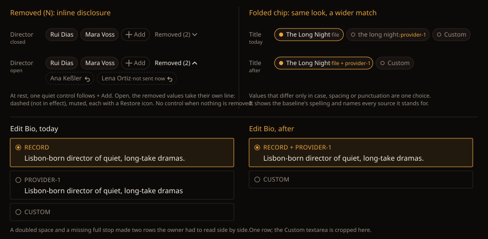

# Handoff: Source choices — Removed (N) and the folded chip

Epic 5 of the frontend backlog: [HOLODEX-69](https://whoiskevinrich.atlassian.net/browse/HOLODEX-69)
(Removed (N)) and [HOLODEX-138](https://whoiskevinrich.atlassian.net/browse/HOLODEX-138) (same-ish
candidates). The owner picked option A, the inline disclosure, on 2026-10-25, and accepted the
folded chip as drawn.

- **Behaviour:** [F30.3g](../specs/metadata-curation.md) (Removed (N)) and
  [F36 P1-6](../specs/field-source-of-truth.md) (same-ish candidates are one choice). This doc
  covers only what the owner sees and touches.
- **Look:** Cinémathèque only ([theming.md](theming.md)). Tokens only.

---

## 1. Removed (N)

### Where it appears

On every owner view of a `CurationFieldRow` for a multi-value field (`field.multi`): the media
page's merge fields, the studio page's, and any person merge field. It never appears for a visitor,
and never on a single-value field, since a single value can't be removed there.

### Anatomy

One row, in this order: the value chips → the row's `ProvenanceBadge` (when there is one) → **+ Add** → **Removed (N)**.

| Part | Spec |
|---|---|
| **Removed (N)** toggle | A `button`, `.btn-quiet` at `text-xs`, with the row's own height. Its label is `Removed (N)`, where N is the count of removed values, followed by a 11px chevron (down when closed, up when open). Muted at rest. It turns `text-ink` when open, and `text-accent` on hover or focus-visible. It isn't rendered at all when N is 0. |
| Removed line | When open, a second line directly under the row, `mt-1.5`, with the same `flex flex-wrap gap-1.5` as the chips. It lines up with the row's first chip, not with the field label. |
| Removed chip | The `CurationChip` shell (`rounded-full`, `min-h-6`, `px-2`, `text-xs`) with a **dashed** `border-rule`, no fill, and `text-muted` value text. It has no edit and no don't-write control. A dashed border is a status here, meaning the value isn't in effect. It isn't an add affordance (see the text CTA rule in `frontend-theming.md`). |
| "not sent now" suffix | When no source currently sends the removed value: `·not sent now` at `text-[0.65rem]` muted, after the value, the same way a choice chip shows its `·source` suffix. |
| Restore | A 12px `arrow-back-up` glyph inside the chip, with the same `ctrl` hit-area classes as the chip's other controls. It is **always visible** and never hover-revealed, because it is the chip's only action. Muted, turning `text-accent` on hover or focus-visible. |

Build the removed chip as a `removed` mode on `CurationChip`, carrying `onrestore` and the
"not sent now" flag. Don't build a sibling component: the shell is the same, and only the border
and the one control differ. Add a `CurationChip` row note to `curation/CLAUDE.md` in the same change.

### States

| State | What the owner sees |
|---|---|
| Nothing removed | No toggle and no line. The row is unchanged from today. |
| Closed (default) | `Removed (N) ⌄` after + Add. The row's height doesn't change. |
| Open | `Removed (N) ⌃` in ink, with the removed line below. Opening is UI-only and stays open while the page is open. A reload closes it. |
| Every value removed | The row still renders for the owner, with only **+ Add** and **Removed (N)**, so the removals stay reachable. A visitor sees no row, as before. |
| Busy | Unchanged: the whole row, removed line included, takes `opacity-60` + `aria-busy` while a request runs. |
| Error | Unchanged: the row's `text-warn` message after the controls. |

### Interactions

| Action | Result |
|---|---|
| Remove a value (✕ on a chip) | The chip leaves the row and N goes up by one. If the line is open, the value appears at the end of it. If the toggle wasn't there before, it now appears closed. |
| Click **Removed (N)** | Toggles the line. Nothing is sent. |
| Restore | The value returns to the row with its original provenance (F30.2e), and N goes down by one. When N reaches 0, the toggle and the line both go away. |
| Restore a "not sent now" value | The chip leaves the removed line, but no chip comes back, because no source sends that value (F30.3g). The live announcement says so (see Accessibility). |
| Re-add a removed value by typing it into + Add | Same as Restore. Typing the same value through + Add adds it back, as it does today. |

No motion. Chips appear and disappear in place, like they do today.

---

## 2. The folded chip

There's no visual change. A choice that stands for several sources already reads
`·file + provider-1` on a choice chip, and `RECORD + PROVIDER-1` on a bio-modal row. What
changes is **when** sources fold together (F36 P1-6): values that differ only in case, spacing or
punctuation now count as the same.

| Surface | Before | After |
|---|---|---|
| Tier-2 chip row (`SourceBadge`, `SourceChipRow`) | `The Long Night ·file` and `the long night. ·provider-1`, two choices | `The Long Night ·file + provider-1`, one choice |
| Pencil + modal (`SourceEditModal` → `SourceRadioList`) | Two rows whose paragraphs differ by a space and a full stop | One `RECORD + PROVIDER-1` row |
| Writeback dialog (embeds the same choosers) | The same as each chooser above | The same as each chooser above |

- **Shown value:** the baseline's spelling, or, when only providers fold together, the first
  provider in trust order. Never a blend.
- **Selecting the folded choice** pins its first source, exactly as an exact-match fold does
  today.
- **Single choice left:** when every candidate folds into the baseline, the row holds that one
  choice plus Custom. `SourceBadge` still renders, because mounting it is the page's
  "curatable" decision (curation `CLAUDE.md` rule).

The change is entirely in the chip model (`sourceChips` in `#lib/f36.ts`, its value comparison).
No component markup changes.

---

## Responsive

| Width | Behaviour |
|---|---|
| ≥ `sm` | As drawn. The removed line wraps like the row. |
| < `sm` | The row and the removed line each wrap at full width. The Restore glyph is already always visible, and its `ctrl` hit area meets the 24px target with the chip's 24px height (HOLODEX-357). |

Long values truncate the same way a curated chip does today. A removed chip never truncates its
"not sent now" suffix: the suffix is `shrink-0` and the value truncates first.

## Accessibility

- **Toggle:** `aria-expanded`, plus `aria-controls` naming the removed line's id. Its accessible
  name is `Removed values for {field label}, {N}`.
- **Removed line:** `role="group"`, `aria-label="Removed from {field label}"`.
- **Removed chip:** `aria-label="{value}, removed"`, or `"{value}, removed, not sent by any source now"`
  when it carries the suffix. The Restore button's name is `Restore {value}`.
- **Focus order:** the row's chips and their controls → + Add → Removed (N) → each Restore, in
  line order. There's no roving tabindex, matching today's `CurationFieldRow`.
- **Focus after Restore:** the next Restore in the line, or the previous one when it was the last.
  When the line empties, focus goes to **+ Add**.
- **Focus after Remove:** unchanged from today.
- **Announcements:** the row gets one `aria-live="polite"` region for these, separate from the
  error text:
  - Remove: "Removed {value}. {N} removed."
  - Restore: "Restored {value}."
  - Restoring a "not sent now" value: "Restored {value}. No source sends it now."

## Edge cases

- **N grows large:** the line wraps. There's no cap and no paging; a field's removals are bounded
  by what the owner did by hand.
- **Don't-write on a removed value:** a removed chip shows no don't-write strike and has no
  don't-write control.
- **Person-link fields (Actors, Director on media):** removed chips are plain text, never person
  links, because a removed value isn't on the page as a person.
- **Visitor:** sees no toggle, no line, no count and no removed value (F30.3g).

## QA (`[smoke]` / `[agent]` / `[human]`)

1. `[agent]` Remove one value from a media merge field: `Removed (1)` appears closed, the row height is unchanged.
2. `[agent]` Open it: the removed chip is dashed and muted, its Restore glyph is visible without hover, and the chevron flips.
3. `[agent]` Restore it: the value returns to the row with its provenance, and the toggle disappears.
4. `[agent]` Remove every value of a field: the row shows only + Add and `Removed (N)`.
5. `[agent]` A removal no source still sends shows `·not sent now`, and restoring it removes it from the line with the matching announcement.
6. `[agent]` A visitor sees none of 1–5.
7. `[agent]` A title whose file and provider-1 values differ only in case and a full stop shows one `·file + provider-1` choice. A bio that differs only in spacing shows one `RECORD + PROVIDER-1` row.
8. `[agent]` At 375px, the row and the removed line wrap with no horizontal scroll.
9. `[human]` Keyboard and screen reader pass over 1–5: focus order, focus after Restore, the three announcements.
10. `[human]` Cinémathèque pass: the dashed chip reads as "not in effect", not as an add affordance.
