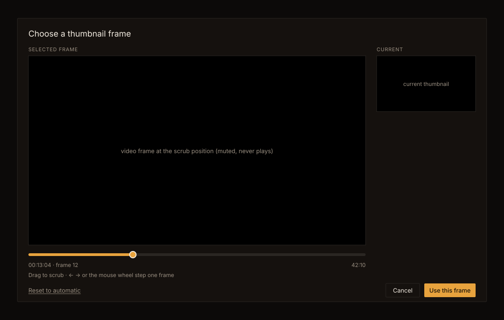

# Handoff Spec: Thumbnail frame picker (F84)

**Story:** HOLODEX-35
**Spec:** [`docs/specs/thumbnail-frame-picker.md`](../specs/thumbnail-frame-picker.md)
**Date:** 2026-10-26 · **Status:** Draft, awaiting owner sign-off at `/implement`

Decided with the owner on 2026-10-26, from side-by-side mockups:
- **The video leads, and the current thumbnail sits in a side rail** (option A). An equal
  side-by-side layout was rejected because it halves the frame being judged.
- **Capture happens in the browser and is stored as an uploaded poster.** Seeking by timestamp with
  ffmpeg was rejected because it lands a frame off on some files (spec, "Rationale"). A separate
  "picked frame" tier was rejected because it would add a state for no difference the owner sees.
- **One frame is measured in the browser**, with a fallback of 1/30 s. Storing the frame rate at
  scan time was rejected because it needs a migration and a rescan.
- **The old one-click regenerate stays reachable** as the picker's quiet "Reset to automatic".

## Mockup

This uses the real Cinémathèque tokens from `app.css`, with the `Modal` at size `media` (64rem).

## Placement

The picker opens from the **Thumbnail** row of the media page's owner-only Maintenance section, from
the existing `btn-ghost` "Regenerate thumbnail" button, which keeps its label. There are no other
entry points.

## Component

`web/src/lib/components/video/ThumbnailFramePicker.svelte`, rendered on `shared/Modal.svelte`
(`size="media"`, `align="center"`, `busy` while a save runs). The pure maths for frame stepping, the
wheel accumulator and the timecode lives in `video/framePicker.ts`, which is unit-tested.

| Prop | Purpose |
|---|---|
| `src` | The stream URL, the same one the page player uses |
| `currentSrc` | The current thumbnail (the page's cache-busted poster URL) |
| `startAt` | Seconds where the picker opens, taken from the page player's position |
| `onuse(file)` | Saves the frame. It resolves on success and throws with a message on failure |
| `onreset()` | Runs the automatic regenerate |
| `onclose()` | Closes with no change |

## Layout

- **Title:** "Choose a thumbnail frame", `text-lg text-ink`.
- **Body:** a two-column grid at `lg`, `minmax(0,1fr) 13.5rem`, that stacks to one column below
  `lg`, with the Current rail under the scrub bar.
  - **Selected frame** (label `text-xs uppercase tracking-wide text-muted`): a `<video>` in a
    `aspect-video bg-black border border-rule` frame, `object-contain`, with no native `controls`.
    Under it sit the scrub bar, then a row with the position on the left (`00:13:04 · frame 12`) and
    the length on the right (`text-xs text-muted tabular-nums`), then the hint line
    "Drag to scrub · ← → or the mouse wheel step one frame".
  - **Current:** the current thumbnail `` in the same frame chrome.
- **Footer:** "Reset to automatic" on the left, as `btn-quiet`. Cancel (`btn-ghost`) and
  "Use this frame" (solid `bg-accent text-accent-ink`, the dialog's one primary action) are on the
  right.

## Scrub bar

- A `role="slider"` track: `h-1.5 rounded-full bg-rule`, an `bg-accent` fill up to the position,
  and a 14px `bg-accent` thumb with an ink ring. It takes focus (`tabindex="0"`) with the shared
  focus ring. `aria-valuemin` is 0, `aria-valuemax` is the length in seconds, `aria-valuenow` is the
  position, and `aria-valuetext` is the timecode string.
- **Pointer:** on `pointerdown` the bar captures the pointer, so a drag that leaves the bar keeps
  scrubbing. The position follows the pointer, and while dragging the seek is coalesced to the
  latest target.
- **Keys** work anywhere in the dialog except while a button has focus: ← and → step one frame.
  On the slider, Home and End jump to the first and last frame.
- **Wheel** over the video or the bar: `preventDefault`, then one step for each 50px of
  accumulated delta (a line-mode notch counts as 100px). The accumulator resets on direction change.

## States

| State | What shows |
|---|---|
| Loading | The frame area is black with "Loading video…" in `text-muted`, and Use this frame is withdrawn |
| Ready | As in the mockup |
| Saving | Use this frame reads "Saving…", all controls are withdrawn, and Escape and the backdrop are ignored |
| Save failed | A `text-sm text-warn` line above the footer gives the reason, and the controls come back |
| Can't decode | The frame area shows "This browser can't decode this file's codec." Only Reset to automatic and Cancel act |

## Silence

The `<video>` is `muted` with `volume = 0`, has no `controls` and no `autoplay`, and the picker never
calls `play()`. Opening the picker pauses the page player.
