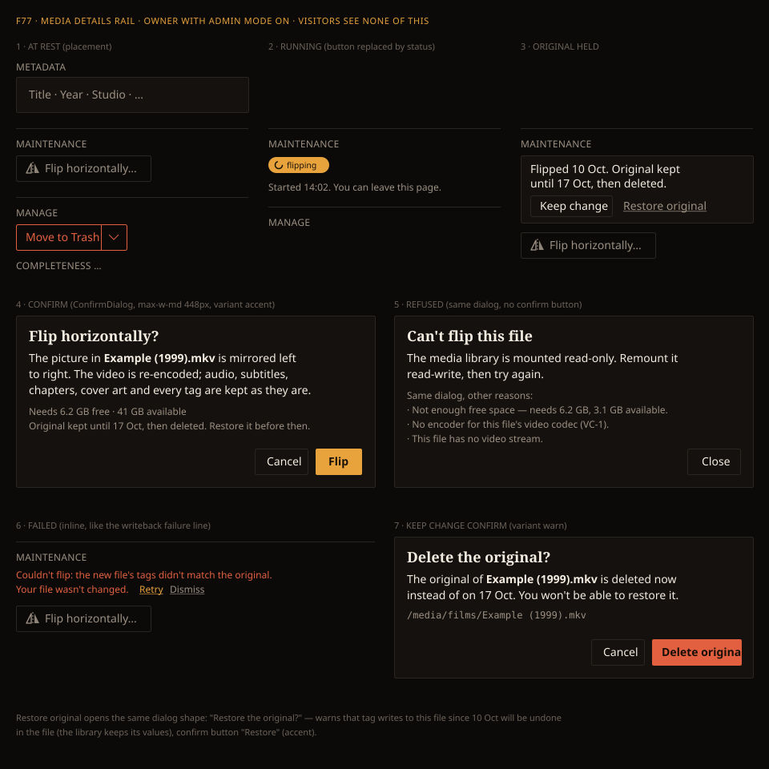

# Design handoff: Video file maintenance (F77)

**Jira:** [HOLODEX-556](https://whoiskevinrich.atlassian.net/browse/HOLODEX-556)
**Spec:** [video-file-maintenance.md](../specs/video-file-maintenance.md) (behaviour, the output contract and refusal reasons live there)
**Surface:** `web/src/routes/media/[id]/+page.svelte`, a new rail section
**Theming contract:** [theming.md](theming.md). Tokens only; QA Cinémathèque.
**Reuses:** `ConfirmDialog` (`web/src/lib/components/shared/ConfirmDialog.svelte`), the Manage section's
heading pattern, and the writeback failure line's Retry/Dismiss pattern.



## 1. Placement

**Maintenance** is its own rail section, directly **above Manage** (the order becomes Metadata, then
Maintenance, then Manage, then Completeness). Chosen 2026-10-10 over two alternatives. Folding it
into Manage would put a repair beside a delete, and that row would overflow once aspect-ratio entries
arrive. Putting it in the File card below the grid would place it next to the path, but far down the
page and easy to miss.

Same treatment as Manage: no card, just a top rule.

```svelte
{#if isOwner}
<section class="space-y-2 border-t border-rule pt-4" aria-labelledby="maintenance-heading">
  <h2 id="maintenance-heading" class="text-xs uppercase tracking-wide text-muted">Maintenance</h2>
  <!-- one entry per operation; v1 has one -->
</section>
{/if}
```

- `isOwner` here is `activity.effectiveOwner`: the owner with Admin mode on. Visitors and an owner
  with Admin mode off render nothing, not even the heading.
- Each part of a multi-part video is its own page with its own file. The section always acts on the
  file of the page it's on, so there is no part picker.
- Entries stack vertically (`flex flex-col items-start gap-2`) so aspect-ratio operations add rows
  without changing the layout.

## 2. Components and states

| # | State | Renders |
|---|---|---|
| 1 | **At rest** | `btn-ghost` button, `inline-flex items-center gap-1.5 rounded-theme px-3 py-1.5 text-sm`: a 16px mirror icon (two triangles across a dashed axis, `currentColor`) and the label **Flip horizontally…**. The ellipsis signals that a dialog follows. |
| 2 | **Queued / running** | The button is replaced (not disabled) by a status pill matching the writeback pending pill: `rounded-full bg-accent px-2 py-0.5 text-[0.65rem] text-accent-ink` with a 12px spinner and **flipping** (**restoring** / **removing original** for those operations, and **queued** for any of them until the worker picks it up). Below it, `text-xs text-muted`: "Started 14:02. You can leave this page." The start time appears once the job is running. P1 adds a percentage to the pill ("flipping 42%"). |
| 3 | **Original held** | A notice above the button: `rounded-theme border border-rule bg-surface px-3 py-2 text-sm text-ink`. It reads "Flipped {date}. Original kept until {expiry}, then deleted." Actions sit in a row `mt-2 flex gap-2`: **Keep change** (`btn-ghost`, ink text) and **Restore original** (`btn-quiet`). The Flip button stays below the notice, because a second flip is allowed. |
| 4 | **Confirm** | `ConfirmDialog`, `variant="accent"`. Title: **Flip horizontally?** Body (`text-sm`): "The picture in **{filename}** is mirrored left to right. The video is re-encoded; audio, subtitles, chapters, cover art and every tag are kept as they are." Then two `text-xs text-muted` lines: "Needs {n} GB free · {m} GB available" and "Original kept until {expiry}, then deleted. Restore it before then." Buttons: **Cancel**, then **Flip**. |
| 5 | **Refused** | The same dialog with no confirm button. Title **Can't flip this file**; the body is the reason in one or two sentences, saying what happened and what to do; the only button is **Close**. Reason copy is listed in §3. If the check itself fails (the request errors, e.g. a file ffprobe can't read), the title is **Can't check this file**, the body says "Holodex couldn't read this file to check it. It may be damaged or unreadable." with the error beneath in `text-xs text-muted`, and **Close** is again the only button. |
| 6 | **Failed** | Matches the writeback failure line: `p.flex.flex-wrap.items-center.gap-2.text-xs.text-warn` reading "Couldn't flip: {reason}. Your file wasn't changed." It is followed by **Retry** (`text-accent underline`, "Retrying…" while busy) and **Dismiss** (`text-muted underline`). The Flip button stays visible below. |
| 7 | **Keep change confirm** | `ConfirmDialog`, warn variant. Title **Delete the original?** Body: "The original of **{filename}** is deleted now instead of on {expiry}. You won't be able to restore it." Then a `font-mono text-xs text-muted truncate` path line, the same shape as the Purge dialog. Buttons: **Cancel**, then **Delete original** (`bg-warn text-warn-ink`). |
| 8 | **Restore confirm** | `ConfirmDialog`, `variant="accent"`. Title **Restore the original?** Body: "**{filename}** goes back to how it was before {date}. Tags written to this file since then are undone in the file; the library keeps its values." Buttons: **Cancel**, then **Restore**. While the restore runs, the notice is replaced by a **restoring** pill styled like state 2. |

The Flip pill is the only accent fill in the section. Keep change is the only warn fill, and it
appears only inside its confirm dialog.

## 3. Copy

| Situation | Text |
|---|---|
| Read-only library | "The media library is mounted read-only. Remount it read-write, then try again." |
| Not enough space | "Not enough free space. This needs {n} GB; {m} GB is available." |
| No encoder | "There's no encoder for this file's video codec ({codec}), so it can't be re-encoded." |
| Dolby Vision | "This file's Dolby Vision picture can't survive a re-encode, so it can't be flipped." |
| No video stream | "This file has no video stream to flip." |
| File missing | "The file isn't on disk. Rescan the library, then try again." |
| Tool missing | "A media tool this file needs isn't installed ({tool})." |
| Unsupported container | "Only .mp4 and .mkv files can be flipped." |
| Already running | The button isn't shown (state 2). If a race gets past that: "This video already has maintenance queued. Wait for it to finish." |
| Failure reasons | "Couldn't flip: {reason}. Your file wasn't changed." (or "Couldn't restore the original" / "Couldn't remove the original"). {reason} names the output-contract rule in plain words: "the new file's tags didn't match the original", "a stream was missing or out of place in the new file", "a stream that should have been copied untouched changed", "the new file's chapters didn't match the original", "the new picture's shape didn't match the original", "the new file's length didn't match the original", "the encoder stopped". A refusal raised while the job ran reads as "Couldn't flip. {refusal sentence} Your file wasn't changed." Never show a raw stderr dump; the full log belongs in job history. |

Dates use the short date format "17 Oct" (the year only when it isn't the current year); the
start time is 24-hour "14:02". Sizes use the page's existing size format (`formatBytes`, as in the
File card), so a small file reads in MB.

## 4. Interactions

- Clicking **Flip horizontally…** opens the dialog in a loading state while the preflight resolves.
  The body shows "Checking…" (`text-sm text-muted`) and the confirm button is withheld. The dialog
  then resolves to state 4 or state 5. It never shows the confirm button first and pulls it away
  afterwards.
- Clicking **Flip** closes the dialog and the section moves to state 2 at once, optimistically. The
  page keeps working normally, and leaving it is fine.
- When the job finishes, the activity poll updates the section to state 3 (success) or state 6
  (failure). On success the player and thumbnail are reloaded; their URL gains a cache-busting version
  so the flipped picture appears without a hard refresh.
- **Restore original** and **Keep change** each open their confirm dialog (states 8 and 7).
- **Dismiss** on a failure hides the line. It does not cancel anything, because nothing is running.

## 5. Responsive

The rail stacks under the subject column below `lg`, and the section goes with it unchanged. The held
notice wraps naturally. Its action row is `flex-wrap`, so on a 360px screen **Restore original**
drops below **Keep change** rather than overflowing. Dialogs use `ConfirmDialog`'s existing
`px-4` overlay gutter.

## 6. Accessibility

- The section is labelled by its heading (`aria-labelledby`).
- The status pill sits in an `aria-live="polite"` region, so "Flipping", "Flipped" and "Couldn't
  flip" are announced. The spinner is `aria-hidden`.
- The mirror icon is decorative (`aria-hidden="true"`); the button's text is its name.
- Dialog focus: on open, the first focusable element. The refused dialog's only button is **Close**.
  For the warn dialog (state 7), focus starts on **Cancel**, matching Purge.
- Focus ring: the standard `focus-visible:ring-1 focus-visible:ring-accent`.
- Contrast: every pairing is an existing token pair already checked (warn on bg 5.62:1, warn-ink on
  warn 5.42:1, accent-ink on accent, muted on bg).

## 7. Out of scope here

Progress percentage, Cancel and a before/after frame are P1 in the spec. When built, each lands in
this section: the percentage goes in the state 2 pill, Cancel as a `btn-quiet` beside it, and the
frame pair inside the state 4 dialog. A list of all held originals belongs to the owner tooling hub,
not this page.
