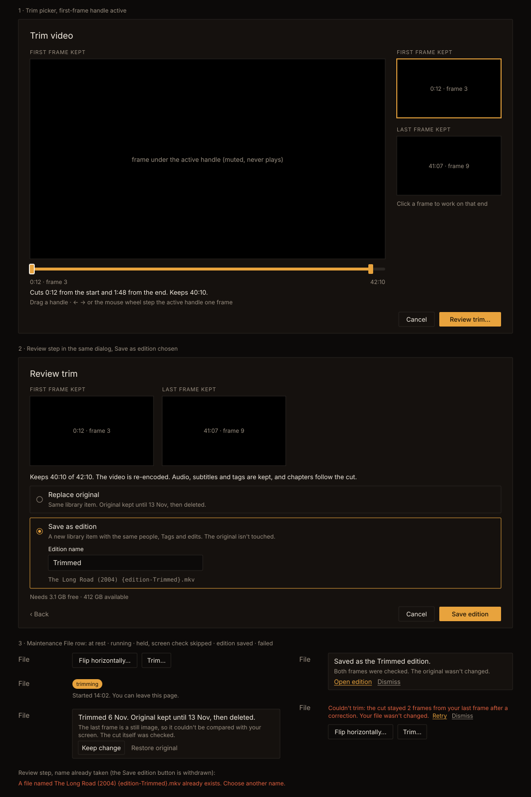

# Handoff Spec: Video trimming (F88)

**Jira:** [HOLODEX-613](https://whoiskevinrich.atlassian.net/browse/HOLODEX-613)
**Spec:** [video-trimming.md](../specs/video-trimming.md) (behaviour, the output contract and the checks live there)
**Builds on:** [frame picker handoff](thumbnail-frame-picker-handoff.md) (F84) and
[maintenance handoff](video-file-maintenance-handoff.md) (F77)
**Theming contract:** [theming.md](theming.md). Tokens only; QA Cinémathèque.

Decided with the owner on 2026-11-06, from side-by-side mockups:
- **Two handles on the scrub bar** set the frames. A playhead with Set first frame and Set last frame
  buttons was rejected: it adds a press per end, and moving a handle commits nothing, so looking
  around is already safe.
- **The save choice is a second step in the same dialog.** Two picker buttons, each with a small
  confirm dialog, were rejected because the frames disappear just as the owner commits.
- **One File row, with one status block.** A separate Length row was rejected: a file runs one job at
  a time and holds one original, so two rows would need Flip to explain itself during a trim.

## Mockup

This uses the real Cinémathèque tokens from `app.css`, with the `Modal` at size `media` (64rem).

## Placement

In the media page's owner-only Maintenance section, the **Picture** row is renamed **File** and gains
**Trim…** beside **Flip horizontally…**. Both are `btn-ghost` in a `flex flex-wrap gap-2` row. The
status block above them (pill, held notice, failure line) is the existing one, now shared by both
operations. There are no other entry points.

## Components

| Component | Notes |
|---|---|
| `video/TrimPicker.svelte` (new) | A sibling of `ThumbnailFramePicker`, on `shared/Modal.svelte` (`size="media"`, `align="center"`, `busy` while enqueuing). A sibling because the commit path and the data differ: two frames and a save choice, not one image. It holds both steps. Reuses `framePicker.ts` (`stepTarget`, `frameInterval`, `timecode`, `WheelStepper`). Capturing a frame to a JPEG moves out of the picker into a helper both call. |
| `video/trimPicker.ts` (new) | The pure parts, unit-tested: the handles' limits, the summary sentence, and the filename preview. |

| `TrimPicker` prop | Purpose |
|---|---|
| `src` | The stream URL, the same one the page player uses |
| `filename` | The file's name, for the filename preview |
| `preflight(mode, name)` | Resolves to the check's result, for the review step |
| `onconfirm(trim)` | Queues the trim with both times, both captures, the mode and the name. It throws with a message on failure |
| `onclose()` | Closes with no change |

## Step 1: Trim picker

- **Title:** "Trim video", `text-lg text-ink`.
- **Body:** F84's grid at `lg`, `minmax(0,1fr) 13.5rem`, stacking below `lg`.
- **Main column:** a label naming the active handle ("First frame kept" or "Last frame kept",
  `text-xs uppercase tracking-wide text-muted`), then the `<video>` in F84's `aspect-video bg-black
  border border-rule` frame, showing the active handle's frame.
- **Under the bar:**
  - F84's position and length row (`text-xs tabular-nums text-muted`), for the active handle.
  - The summary, `text-sm text-ink`: "Cuts 0:12 from the start and 1:48 from the end. Keeps 40:10."
    With one end cut: "Cuts 0:12 from the start. Keeps 41:58." With nothing cut: "Move a handle to
    choose what to cut." A cut under a second reads "less than a second", because a cut of a few frames
    would otherwise read "0:00".
  - The hint, `text-xs text-muted`: "Drag a handle · ← → or the mouse wheel step the active handle
    one frame".
- **Rail:** "First frame kept" and "Last frame kept", each a `<button>` holding a still in F84's frame
  chrome with its time beneath the image. The active one has a 2px `border-accent`. Under them,
  `text-xs text-muted`: "Click a frame to work on that end". Each still is redrawn from the video when
  its handle comes to rest, and these are the captures the screen check uses.
- **Footer:** Cancel (`btn-ghost`) and **Review trim…** (solid `bg-accent text-accent-ink`, the
  dialog's one primary action), on the right.

### Scrub bar

The track is F84's: `h-1.5 rounded-full bg-rule`. The kept range between the handles is `bg-accent`;
the parts to be cut stay `bg-rule`.

- **Handles:** two `role="slider"` elements, 10×20px `bg-accent rounded-theme`, each with a 44px touch
  target. The active handle has F84's `ring-2 ring-ink`. Pressing or focusing a handle makes it active.
- **Limits:** a handle stops one frame short of the other, so at least two frames are kept and the
  handles never cross.
- **Pointer:** pressing a handle captures the pointer, and seeks coalesce as in F84. Pressing the
  track moves the nearer handle there.
- **Keys:** ← and → step the active handle one frame anywhere in the dialog, except while a button
  has focus. On a handle, Home and End jump to that handle's limit. Tab moves between the handles.
- **Wheel:** over the video or the bar, F84's accumulator steps the active handle.
- **On open:** the handles sit on the file's first and last frames, and the first is active. The
  file isn't opened at the player's position, because the trim is about the two ends.

### States

| State | What shows |
|---|---|
| Loading | The frame area is black with "Loading video…" in `text-muted`, the rail's stills are empty, and Review trim… is withdrawn |
| Nothing to cut | Both handles at the file's ends: the "Move a handle" summary, and Review trim… withdrawn (ghost look, never dimmed) |
| Ready | As in the mockup |
| Can't decode | The frame area shows "This browser can't decode this file's codec." Only Cancel acts |

## Step 2: Review

The same `Modal` swaps its content, so the dialog never closes and reopens. Focus moves to the
"Review trim" heading (`tabindex="-1"`).

- **Frames:** the two stills side by side, each labelled, `sm:grid-cols-2` with each at most 16rem
  wide. They aren't buttons here; ‹ Back is the way to change them.
- **Summary**, `text-sm text-ink`: "Keeps 40:10 of 42:10. The video is re-encoded. Audio, subtitles
  and tags are kept, and chapters follow the cut."
- **Save choice:** a `fieldset` with a visually hidden legend and two radio rows, `rounded-theme border
  border-rule px-3 py-2`, the chosen row `border-accent`. **Replace original** is chosen on arrival,
  because the owner's usual aim is to be rid of the extra footage and it can be undone until the date
  it states.
  - **Replace original:** "Same library item. Original kept until {expiry}, then deleted."
  - **Save as edition:** "A new library item with the same people, Tags and edits. The original isn't
    touched." When chosen, it reveals **Edition name** (a text input prefilled "Trimmed", selected when
    revealed) and the new filename below it (`font-mono text-xs text-muted`, wrapping anywhere). The
    preview updates as the owner types and shows the name as it will be written.
- **Space:** `text-xs text-muted`: "Needs {n} free · {m} available".
- **Footer:** ‹ Back (`btn-quiet`) on the left, which keeps the handles where they were. Cancel
  (`btn-ghost`) and the primary on the right, reading **Replace original** or **Save edition**.

### States

| State | What shows |
|---|---|
| Checking | "Checking…" (`text-sm text-muted`) in place of the space line, with the primary withdrawn. It is never shown and then pulled away |
| Refused | The save choice and the space line are replaced by the reason (F77's copy, with "trim" for "flip"). Only ‹ Back and Cancel act |
| Name refused | A `text-xs text-warn` line under the filename replaces nothing else, and the primary is withdrawn. Copy below |
| Queuing | The primary reads "Queuing…", controls are withdrawn, and Escape and the backdrop are ignored |
| Couldn't queue | A `text-sm text-warn` line above the footer gives the reason, and the controls come back |

## The File row's states

Same chrome as F77's states, with the copy below. The pill and "Started 14:02. You can leave this
page." are unchanged, and the buttons are replaced by them while a job is queued or running. Status
sits in the existing `aria-live="polite"` region.

| State | Renders |
|---|---|
| At rest | **Flip horizontally…** and **Trim…** |
| Queued / running | Pill: **queued**, then **trimming**. A corrected second run stays **trimming** |
| Replaced, original held | F77's held notice: "Trimmed {date}. Original kept until {expiry}, then deleted." with **Keep change** and **Restore original** |
| Screen check skipped | One more line in that notice, `text-xs text-muted`, copy below. A replace with nothing skipped has no extra line |
| Edition saved | A notice in the same chrome, no held actions: "Saved as the {name} edition." then a `text-xs text-muted` line, then **Open edition** (`text-accent underline`) and **Dismiss** (`text-muted underline`). It stays until dismissed, because the owner usually comes back to it later |
| Failed | F77's failure line, with Retry and Dismiss. The buttons stay below |

If an original is already held from an earlier flip, the notice keeps naming that first operation and
its date, since Restore goes back to before it.

**On the new edition's page:** the File row carries one more line under its buttons, `text-xs
text-muted`: "Trimmed from {title}", linking to the original (`text-accent underline`). The media page
has no job history, so this is where the edition's first history entry shows. It stays for as long as
the original exists, and it is owner-only like the rest of the section.

## Copy

| Situation | Text |
|---|---|
| Skipped, one frame | "The {first or last} frame is a {still image, black frame or slow fade}, so it couldn't be compared with your screen. The cut itself was checked." |
| Skipped, both frames | "Neither frame could be compared with your screen, because they barely differ from their neighbours. The cut itself was checked." |
| Edition saved, nothing skipped | "Both frames were checked. The original wasn't changed." |
| Edition saved, skipped | The skipped line, then "The original wasn't changed." |
| Failed, cut check | "Couldn't trim: the cut stayed {n} frames from your {first or last} frame after a correction. Your file wasn't changed." |
| Failed, screen check | "Couldn't trim: the file and your screen disagreed by {n} frames about your {first or last} frame after a correction. Your file wasn't changed." |
| Failed, other scene | "Couldn't trim: your {first or last} frame on screen didn't match the file at that point. Your file wasn't changed." |
| Failed, other | F77's "Couldn't trim: {reason}. Your file wasn't changed.", with "the new file's chapters didn't match what was expected" for the chapters rule and "the new file's length didn't match what you chose" for the length rule |
| Second video track | "This file has a second video track, which can't be cut on the frames you choose, so it can't be trimmed." |
| FLAC in Matroska | "This file's FLAC audio can't be cut yet, so it can't be trimmed." |
| Name empty | "Enter a name for this edition." |
| Name matches the original's | "This video is already the {name} edition. Choose another name." |
| Name's file exists | "A file named {filename} already exists. Choose another name." |

## Interactions

- **Trim…** pauses the page player and opens step 1.
- **Replace original** or **Save edition** closes the dialog, and the row moves to the pill at once.
  Leaving the page is fine.
- When the job finishes, the activity poll updates the row. After a replace, the player and thumbnail
  reload through F77's cache-busted URLs. After an edition, the page's own video is unchanged.
- **Escape and the backdrop** close the dialog from either step with no change, except while queuing.

## Silence

As F84: the `<video>` is `muted` with `volume = 0`, has no `controls` and no `autoplay`, and the
picker never calls `play()`.

## Edge cases

- **A long edition name:** the input scrolls and the filename preview wraps. Characters that can't be
  in the name are dropped in the preview, so what's shown is what's written.
- **A file that already has an edition:** the preview replaces its marker, so it never shows two.
- **A very short video:** the handles still stop one frame apart. On a narrow bar they overlap
  visually, and the active handle draws on top.
- **Variable frame rate:** one frame is measured as in F84, and the time beneath each still comes
  from the frame shown.

## Responsive

Below `lg` the rail moves under the bar as two tiles in a row (`grid-cols-2`). Below `sm` the review
step's stills stack. The dialog body scrolls, with the footer inside it as in F84. The File row's
buttons wrap, so **Trim…** drops below **Flip horizontally…** on a 360px screen.

## Accessibility

- **Handles:** `aria-label` "First frame kept" and "Last frame kept". `aria-valuemin` and
  `aria-valuemax` are that handle's limits, `aria-valuenow` its position, and `aria-valuetext` its
  timecode.
- **Rail stills:** buttons with `aria-pressed` for the active end, named "Work on the first frame,
  0:12".
- **Summary:** in an `aria-live="polite"` region, announced when a handle comes to rest, not on every
  step of a drag.
- **Name refusal:** `role="alert"`, tied to the input with `aria-describedby`.
- **Focus ring:** the standard `focus-visible` ring, as on F84's bar.
- **Contrast:** every pairing is an existing checked token pair.

## Out of scope here

Previewing the edges, jumping to scene changes, progress and cancel are P1 in the spec. When built,
the first two land in step 1's button row under the bar, and the last two in the pill as F77 describes.
