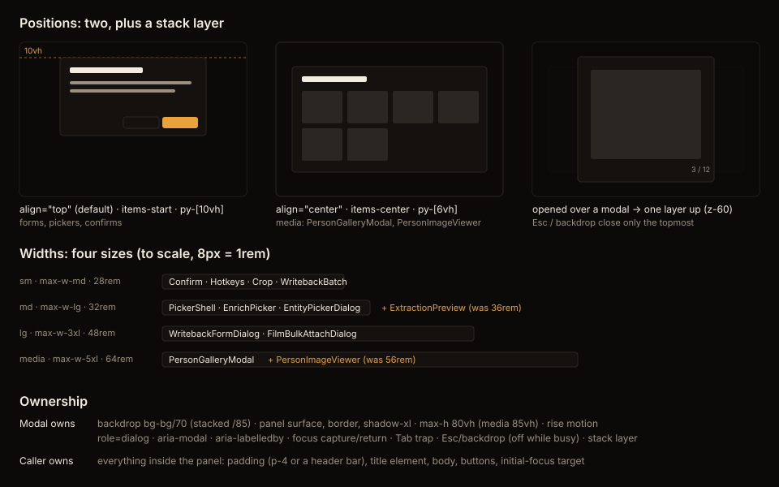

---
# Flightplan worklog — one epic, one worklog, one definition of done.
# Schema + design: see the Flightplan plugin's own README and ADR-001 (in the plugin repo).
key: HOLODEX-215
status: in-progress
profile: ui                  # design-system refactor; no product rule changes
depends-on: []
approved:
  design:
    on: 2026-10-14
    at: faf89657       # re-confirmed 2026-10-14 after the build's focus/Escape doc delta
release_note: Dialogs now open in consistent positions and widths, and Escape closes only the topmost dialog. It no longer also closes the one beneath or clears the page's filters.
---

# HOLODEX-215 · Consolidate hand-rolled modals into one shared Modal primitive

Eleven dialogs each build their own modal shell. They use five vertical paddings, seven widths,
two z-indices and seven focus-trap selectors. Escape is bound in three places, so one keypress
can close several dialogs at once. The ticket counted nine dialogs. Since then `PickerShell`
already wraps seven pickers, and `HotkeySheet` and `WritebackBatchDialog` were added.

**Design package:** [shared-modal-handoff.md](../design/shared-modal-handoff.md) ·

## Gates — definition of done

- [x] design `design-handoff` → `docs/design/**` — two positions, four widths, stack-aware Escape and layer, Modal owns the surface; the owner approved all four plus the stacked `/85` backdrop on 2026-10-14
- [x] frontend → `web/src/**` — `shared/Modal.svelte` + 11 call sites migrated; no hand-rolled shell or trap is left (FilterPanel, a sheet the handoff puts out of scope, keeps the shared `focusTrap.ts`); live QA in Cinémathèque on the stress fixture, and the owner confirmed the build matches the mockup
- [x] testing `testing-strategy` — browser-mode `Modal.svelte.test.ts` (6 tests: focus/return, trap, busy, claimed Escape, backdrop, stack); 7/7 mutants killed; §30 in `docs/testing-strategy.md`

## Up next — ordered (position = priority)

1. [ ] [—] Merge PR #519 and confirm CI moves HOLODEX-215 to Done

## Session log — append-only (cap: last 8 sessions; older → archive/)

### 2026-10-14 · session
- skills: design-handoff, implement, code-review (high --fix), handoff
- handoff: Modal built and all 11 dialogs migrated, live-QA'd, review fixes in, and the sign-off re-confirmed at faf89657. PR #519 is marked ready. Next: merge it. ExtractionPreview, WritebackBatch and EntityPickerDialog were type-checked but not opened live, since the fixture has no rows for them.

## Dropped — newest first (the reason is the point)
